# SecureChat: Building the Future of Open and Secure Messaging

[](LICENSE)
 
 

**SecureChat** is more than a messaging platform. It is an open-source learning and reference project designed to explore, demonstrate, and advance the practical implementation of modern secure communication technologies.

Built around established cryptographic standards such as the **Signal Protocol and Messaging Layer Security (MLS)**, SecureChat provides a practical environment for understanding how **end-to-end encryption(E2EE), secure group communication, multi-device synchronization, and privacy-preserving infrastructure work together** in a real-world messaging system.

Our goal is to make secure messaging technologies easier to understand, learn, evaluate, and build upon. Through open architecture, transparent documentation, practical examples, and shared knowledge, developers, students, security researchers, and technology enthusiasts can explore the design, implementation, and challenges of building privacy-focused communication systems.

SecureChat is also an open invitation to the community. We welcome developers and contributors to explore the codebase, share ideas, identify improvements, report issues, and contribute new features.

We believe that knowledge should be shared, security should be open to scrutiny, and innovation should be something everyone can participate in.

**Learn. Explore. Build. Contribute.**

Together, let's make secure communication more accessible, transparent, and understandable for everyone.

### Design principles

- **The server never sees plaintext or private keys.** Encryption happens on each device with maintained protocol
  libraries — the Signal Protocol for one-to-one chats and MLS (RFC 9420) for groups. No custom cryptography.
- **Every device is a first-class participant.** Each browser/device has its own keys, its own delivery state and
  its own receipts; a new device gets history from the user's other devices, not from the server.
- **Reliable by design, not by luck.** A message is acknowledged only after it is durably stored; events reach Kafka
  through an outbox; every consumer is idempotent; offline devices receive everything when they reconnect.
- **Operators see metadata, never content.** The Admin Portal traces each message through the pipeline (accepted →
  delivered → read, per device) and manages accounts, but has no way to read messages or keys.
- **Clear service boundaries.** Each microservice owns its data store, so the system can later scale service by
  service (see the roadmap).

### Who it is for

- **Developers and architects** learning how secure messaging systems are built end to end.
- **Teams prototyping** a private chat product or an internal secure-messaging tool.
- **Students and security researchers** who want a working system to study, test and attack (responsibly — see [SECURITY.md](SECURITY.md)).

### How a message travels

```text
Alice's browser                     servers (see ciphertext only)                    Bob's devices
───────────────                     ─────────────────────────────                    ─────────────
encrypt with Signal / MLS  ──►  Message Service: store ciphertext + outbox  ──►  Kafka
                                Fanout: one delivery task per recipient device
                                Delivery + WebSocket gateway: push to online devices,
                                keep for offline ones, replay on reconnect          ──►  decrypt on each device
                                                                                         ACK → delivered / read
```

### What's included

- **One-to-one**: Signal Protocol (X3DH + Double Ratchet) · **Groups**: MLS (RFC 9420).
  Encryption and decryption happen **only in the browser**; the backend stores and routes
  ciphertext and public keys. No custom cryptography.
- **Reliability**: Cassandra outbox with an explicit atomicity boundary → Kafka (`acks=all`,
  idempotent producer, ACK awaited); idempotent consumers; durable per-device delivery with
  device ACKs, retries, expiry and reconnect replay.
- **History**: "Load older messages" pages one month per click; a new device gets the last month
  **automatically** from the user's other devices (HPKE-encrypted relay, "sent to new device — Revoke"
  notice); group admins choose at invite how much earlier history a new member sees (none / last 100 /
  10 min … 30 days / all), fulfilled by any member device that holds it.
- **Groups**: roles OWNER / ADMIN / MEMBER (owner invites as admin or member, admins invite members, owner
  promotes/demotes, owner+admins edit the group), any member can rotate group keys.
- **Edit & delete (WhatsApp style)**: edit your own message within **1 hour** (shown as "edited"); **delete
  for everyone** within **24 hours** (removed from every device and from server history, shown as "This message
  was deleted"); **delete for me** at any time.
- **Disappearing messages**: per-chat timer Off / 5 min / 15 min / 1 h / 3 h / 10 h / 1 / 3 / 7 / 30 days, set by
  any member; everyone is told and the chat header shows it; messages disappear from every device and the server
  (Cassandra TTL) that long after they were sent.
- **Welcome tour** for new users: starting a one-to-one chat, creating a group and the main features, on the real
  buttons. Opens after sign-up (or on first login with no chats); replay it from ⚙ → **Help & tour**. Operators can
  turn it off with `ONBOARDING_ENABLED=false` in `.env` (then `docker compose up -d frontend`, no rebuild).
- **Account**: view/change email, change password (other sessions signed out), revoke/remove devices.
- **Chat theme**: System / Light / Dark, 6 colour themes, 4 wallpaper patterns (stored on the device only).
- **Admin Portal**: Argon2id + TOTP MFA (required per admin, chosen at creation), RBAC (5 roles), admin
  lock/unlock/delete (last SUPER_ADMIN protected), user search with email, suspend/reactivate, message
  lifecycle trace per device, reports for any date/time range, service health, alerts/incidents, audit —
  metadata only, never content or keys.

> Scope: today SecureChat supports **text** messaging. Replies/reactions and push notifications are the
> near-term focus; photos, files and calls are future improvements — see the [Roadmap](#roadmap). The single-host deployment is **not highly available** — see
> [Running in production](#running-in-production).

## Screenshots

### Chat client

| Sign in | Create account |
|---|---|
| 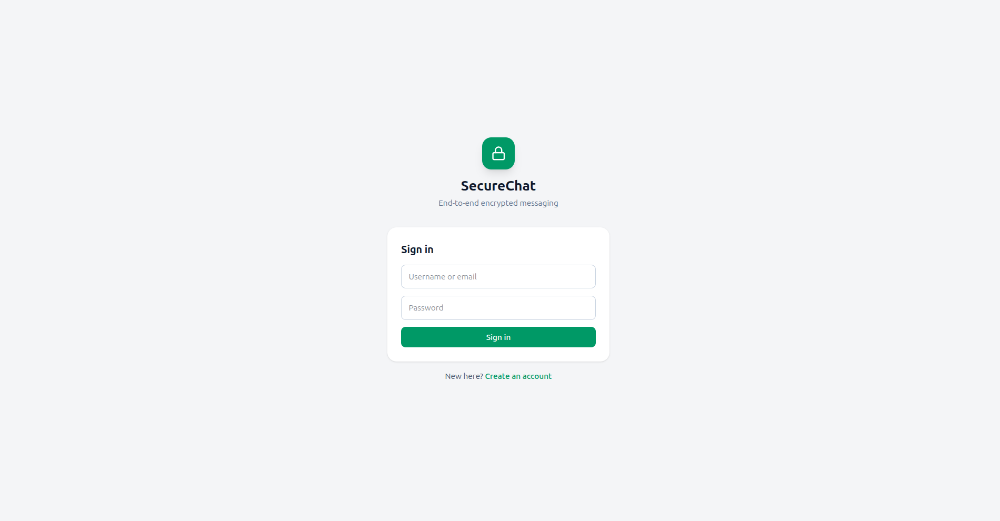 | 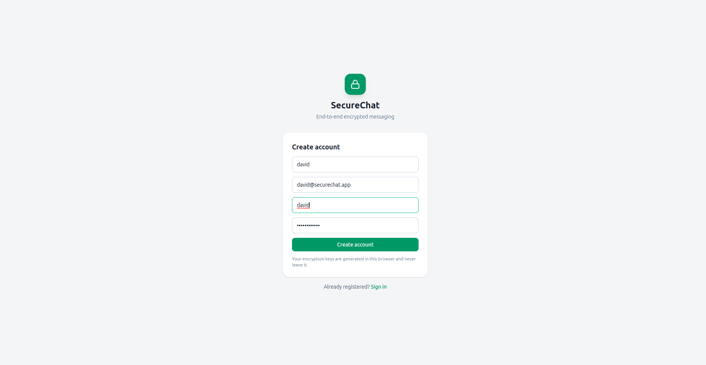 |
| **One-to-one chat (Signal Protocol)** | **Group chat (MLS) with read receipts** |
| 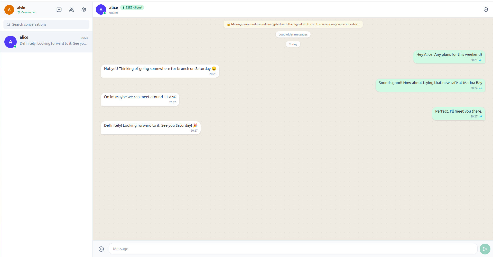 | 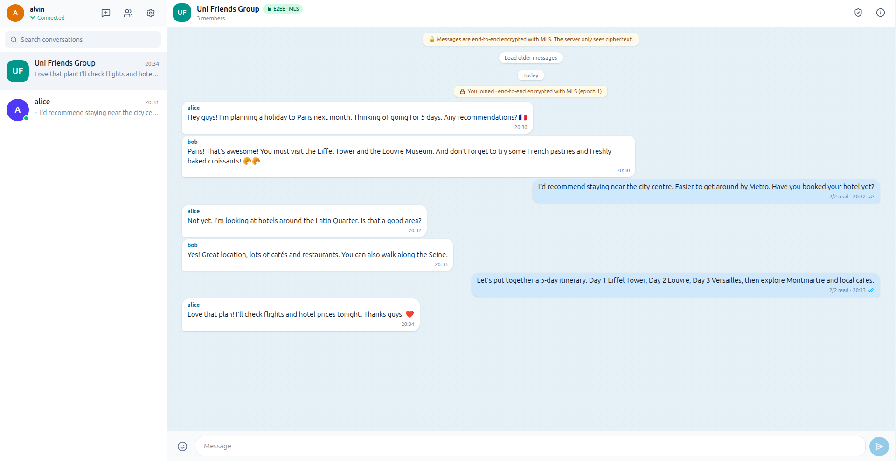 |
| **Devices & security** | **Help & tour (welcome tour for new users)** |
| 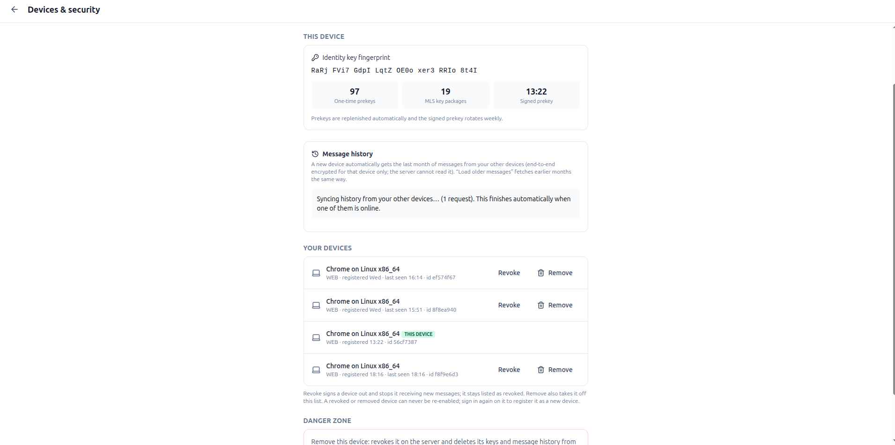 | 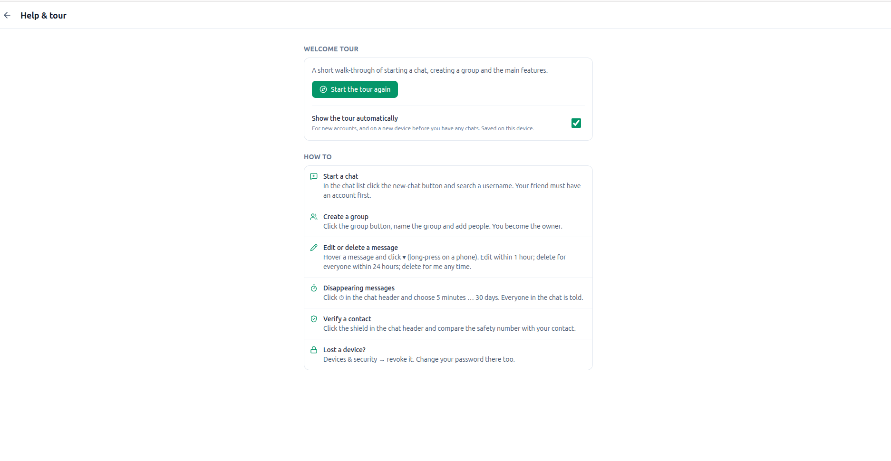 |
| **Welcome tour (first login)** | |
| 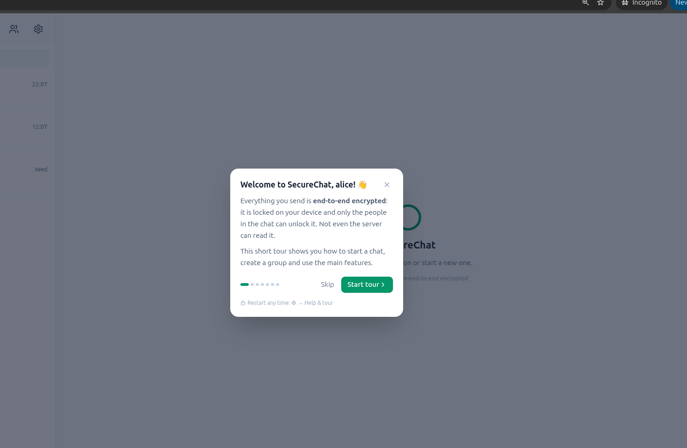 | |

### Admin Portal — metadata only, never message content

| System dashboard | Service health, alerts and incidents |
|---|---|
| 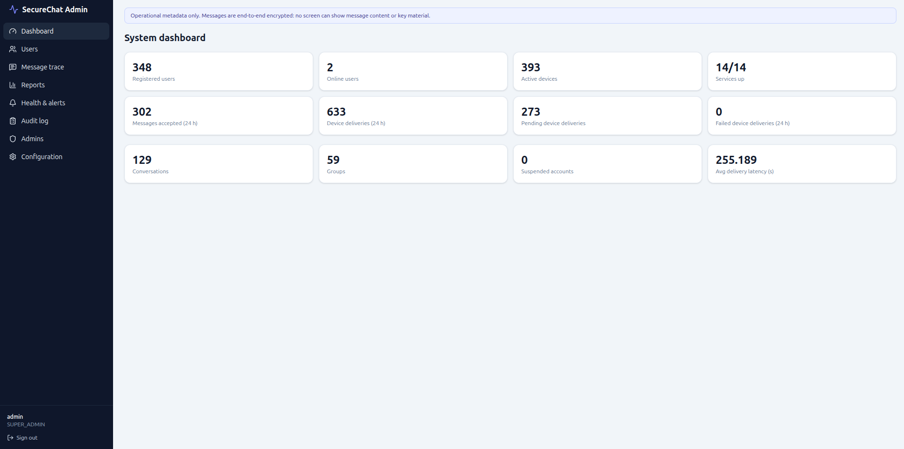 | 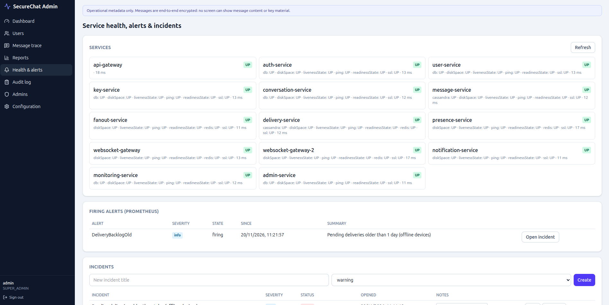 |
| **Reports for any date range** | |
| 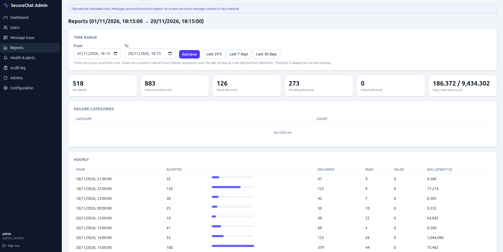 | |

### Monitoring — Grafana

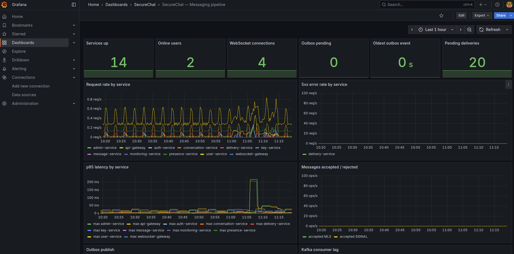

## Quick start (one click)

### 1. Install the prerequisites (once)

| Need                    | Check                              | Install (Ubuntu / Debian)                                 |
| ----------------------- | ---------------------------------- | --------------------------------------------------------- |
| Docker Engine           | `docker --version`                 | `curl -fsSL https://get.docker.com \| sh`                 |
| Docker Compose **v2**   | `docker compose version`           | included with the Docker install above                    |
| Run Docker without sudo | `docker info`                      | `sudo usermod -aG docker $USER`, then log out and back in |
| openssl, git            | `openssl version`, `git --version` | `sudo apt install -y openssl git`                         |

You also need **~10 GB free RAM** and ~15 GB disk. On Windows, use **WSL2** with Docker Desktop's WSL integration.
Java 21, Maven and Node 22 are only needed if you want to run the tests.

### 2. Get the code and run the setup script

```bash
git clone https://github.com/zach7d0/securechat.git
cd securechat
./scripts/setup.sh
```

If you see `Permission denied`, run it as `bash scripts/setup.sh` (or `chmod +x scripts/*.sh` once).

The **first run takes about 10–20 minutes** (it downloads base images and builds 13 services and 2 web apps).
Later runs take a minute or two. The script:

1. checks the prerequisites above (and tells you exactly what is missing);
2. **generates every secret for your machine** — `.env` from [`.env.example`](.env.example) with random passwords,
   the RSA JWT signing keys and the Prometheus password file in `secrets/` (all git-ignored, never shared);
3. builds the images and starts everything in the right order;
4. waits until every service reports healthy and runs a health check;
5. **prints your logins**, ending like this:

```text
==> Done
  Chat app        http://localhost:8100
  Admin Portal    http://localhost:8101    username: superadmin   password: <generated>
  Grafana         http://127.0.0.1:8130    username: admin        password: <generated>
  Prometheus      http://127.0.0.1:8191    username: prometheus   password: <generated>
```

Want to choose your own passwords instead of random ones? Pass them on the **first** run:

```bash
ADMIN_BOOTSTRAP_PASSWORD='a-long-passphrase' GRAFANA_ADMIN_PASSWORD='another-one' ./scripts/setup.sh
```

### 3. Try it

1. Open **http://localhost:8100**, click **Create an account**. A short **welcome tour** shows how to start a chat
   and create a group (skip it, or replay it later from ⚙ → **Help & tour**).
2. Open a second browser profile or a private window, create a second account, and start a chat with the first
   one (search by username). Messages are encrypted in the browser; the server only stores ciphertext.
3. Open **http://localhost:8101** (Admin Portal) with the printed `superadmin` login. You must set a new password on
   first login; after that the printed password no longer works.

### 4. Everyday commands

| Command                           | What it does                                                                                   |
| --------------------------------- | ---------------------------------------------------------------------------------------------- |
| `./scripts/credentials.sh`        | show the URLs and logins again (`--save` writes a private, git-ignored `CREDENTIALS.local.md`) |
| `./scripts/setup.sh --skip-build` | start again without rebuilding (safe to re-run any time; keeps secrets and data)               |
| `./scripts/stop.sh`               | stop everything, keep the data                                                                 |
| `./scripts/start.sh`              | start again after a stop                                                                       |
| `./scripts/health.sh`             | check every container, datastore and service                                                   |
| `./scripts/cleanup.sh` | **clean-up menu**: stop services · remove containers · clear monitoring data · clear all chat databases · clear everything — asks you to type `permanent-delete` or `deleteAll` to confirm (`--dry-run` shows what it would do) |
| `./scripts/reset.sh --yes` | quick: remove containers and **all data volumes** (keeps `.env`, secrets and images) |

### 5. If something goes wrong

| Symptom                                              | Fix                                                                                                                                                                                                                                                        |
| ---------------------------------------------------- | ---------------------------------------------------------------------------------------------------------------------------------------------------------------------------------------------------------------------------------------------------------- |
| `Docker is not running, or this user cannot use it`  | start Docker (`sudo systemctl start docker`) and add yourself to the `docker` group (step 1)                                                                                                                                                               |
| `port is already allocated` (8100, 8101, 8130, 8191) | stop whatever uses the port, or change `CHAT_HTTP_PORT` / `ADMIN_HTTP_PORT` / `GRAFANA_PORT` / `PROMETHEUS_PORT` in `.env` (if you change 8100 or 8101, also update `CHAT_ORIGIN` / `ADMIN_ORIGIN` to the new URL), then `./scripts/setup.sh --skip-build` |
| a service is `unhealthy` / setup stops waiting       | `docker compose logs <service>`; low RAM is the usual cause — close other apps and re-run `./scripts/setup.sh`                                                                                                                                             |
| lost the Admin Portal password after changing it | `./scripts/cleanup.sh` → option 4 (clear databases), then `./scripts/start.sh`; or option 5 then `./scripts/setup.sh` for a completely fresh install |
| browser shows an old version after an update         | hard-refresh with Ctrl+Shift+R                                                                                                                                                                                                                             |

### Logins

Show them again any time with `scripts/credentials.sh` (`--save` writes a git-ignored `CREDENTIALS.local.md`):

| What                  | URL                   | Login                                                                                                                                                          |
| --------------------- | --------------------- | -------------------------------------------------------------------------------------------------------------------------------------------------------------- |
| Chat app              | http://localhost:8100 | no default user — click **Create an account** (use two browser profiles to chat with yourself)                                                                 |
| Admin Portal          | http://localhost:8101 | `ADMIN_BOOTSTRAP_USERNAME` (default `superadmin`) / `ADMIN_BOOTSTRAP_PASSWORD` — forced password change at first login, then TOTP if `ADMIN_MFA_REQUIRED=true` |
| Grafana               | http://127.0.0.1:8130 | `admin` / `GRAFANA_ADMIN_PASSWORD` — dashboard "SecureChat — Messaging pipeline"                                                                               |
| Prometheus            | http://127.0.0.1:8191 | `PROMETHEUS_USER` / `PROMETHEUS_PASSWORD`                                                                                                                      |
| Kafka UI *(optional)* | http://127.0.0.1:8190 | `docker compose --profile tools up -d kafka-ui` — no login, localhost only                                                                                     |
| pgAdmin *(optional)*  | http://127.0.0.1:8192 | `docker compose --profile tools up -d pgadmin` — `PGADMIN_EMAIL` / `PGADMIN_PASSWORD`; DB password is `POSTGRES_PASSWORD`                                      |

All values come from your generated `.env`; there are **no shared default passwords** in the repository.

Day to day: `scripts/start.sh` · `scripts/stop.sh` (keeps data) · `scripts/health.sh` ·
`scripts/cleanup.sh` (clean-up menu) · step-by-step alternative: `scripts/gen-secrets.sh` then
`scripts/start.sh --build`.

## Architecture

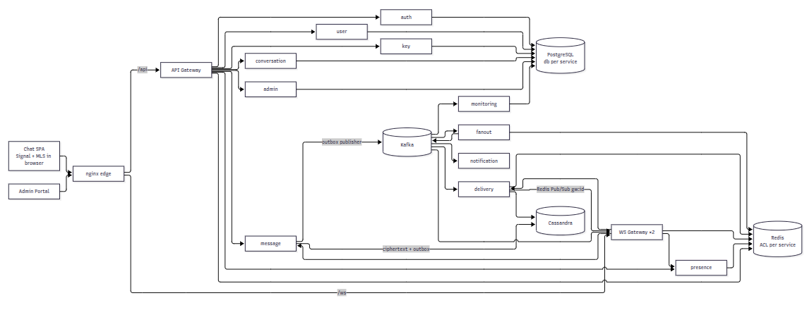

Browsers talk to one **nginx edge**: REST calls go through the **API Gateway** to the services, real-time traffic
goes to the **WebSocket gateways**. Messages are persisted as ciphertext in **Cassandra** with an outbox, published to
**Kafka**, fanned out per recipient device and pushed through the gateway that holds each device's socket (routed via
**Redis**). Each service owns its own **PostgreSQL** database; Redis users are separated by ACL per service.

<details>
<summary>Same diagram as code (Mermaid)</summary>

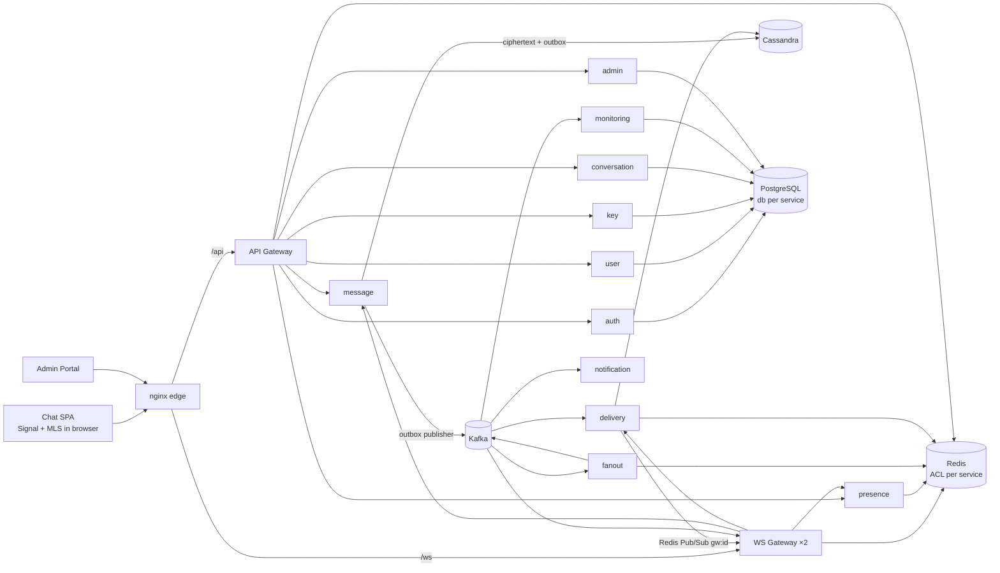

</details>


| Service                | Owns                                                                                                                  | Store                           |
| ---------------------- | --------------------------------------------------------------------------------------------------------------------- | ------------------------------- |
| api-gateway            | routing, JWT pre-validation, Redis rate limits                                                                        | —                               |
| websocket-gateway (×2) | sockets, connection registry, cross-gateway routing                                                                   | Redis                           |
| auth-service           | credentials (Argon2id), email/password change, rotating refresh tokens, device-bound JWTs, JWKS                       | PostgreSQL `auth_db`            |
| user-service           | profiles, search, contacts, devices (register/revoke/remove), automatic encrypted history-sync relay                  | PostgreSQL `user_db`            |
| key-service            | public identity/signed/one-time prekeys, MLS key packages, atomic claims                                              | PostgreSQL `key_db`             |
| conversation-service   | conversations, membership, roles, MLS commit log (epoch CAS), welcomes, group history grants + ciphertext share relay | PostgreSQL `conversation_db`    |
| message-service        | ciphertext persistence, idempotency, Cassandra outbox + publisher, history                                            | Cassandra `securechat_message`  |
| fanout-service         | members × active devices → deterministic per-device tasks                                                             | Redis cache                     |
| delivery-service       | per-device pending, receipts, retry/expiry, replay                                                                    | Cassandra `securechat_delivery` |
| presence-service       | device-derived presence (TTL + Lua), presence events                                                                  | Redis                           |
| notification-service   | generic content-free push (pluggable provider)                                                                        | —                               |
| monitoring-service     | lifecycle projection + reports (own consumer group)                                                                   | PostgreSQL `monitoring_db`      |
| admin-service          | admin identities, MFA, RBAC, audit, incidents                                                                         | PostgreSQL `admin_db`           |

## Tests

```bash
cd backend && mvn verify                 # unit + contract + Testcontainers integration tests (real PG/Cassandra/Kafka/Redis)
cd frontend && npx vitest run            # client E2EE tests (real libsignal + ts-mls)
set -a && . ./.env && set +a            # system tests read credentials (e.g. the Cassandra plaintext scan) from .env
cd frontend && npx tsx system/e2e.ts     # end-to-end against the running stack (incl. plaintext scan)
cd frontend && npx tsx system/admin-e2e.ts   # Admin Portal end-to-end
cd frontend && npx tsx system/history-transfer.ts     # automatic device-to-device history sync + Load older
cd frontend && npx tsx system/group-history-share.ts  # group history for new members (grants, any-member fulfilment)
cd frontend && npx tsx system/group-roles.ts          # group roles: invite role, promote/demote, edit
cd frontend && npx tsx system/group-late-device.ts    # new member / new browser joins and receives shared history
cd frontend && npx tsx system/edit-delete-disappear.ts # edit (1 h), delete for everyone (24 h) / for me, disappearing timer
cd frontend && npx tsx system/failure.ts     # failure-injection matrix (stops/kills containers)
tests/failure/backup-restore-drill.sh --yes  # DESTRUCTIVE backup → wipe → restore → verify
```

## Repository layout

```
backend/            Maven reactor: platform/{contracts,service-support,test-support}, services/*
frontend/           chat SPA (src/lib/crypto = client E2EE; system/ = system & failure tests)
admin-portal/       Admin Portal SPA (separate origin)
infra/              postgres init, cassandra auth/init, redis ACLs, kafka topics, nginx edge, prometheus, grafana
scripts/            setup (one click), credentials, cleanup (menu), gen-secrets, start, stop, reset, health, backup, restore, host-check
tests/              failure-injection drills and browser walkthrough scripts (run outputs go to tests/*/evidence/, git-ignored)
docs/               specs (SECURECHAT_*.md), conventions, E2EE client, outbox runbook, EC2 deployment
screenshots/        images used in this README
```

## Documentation

| Document                                                                                                                                                                                     | Contents                                                                                                                                                                              |
| -------------------------------------------------------------------------------------------------------------------------------------------------------------------------------------------- | ------------------------------------------------------------------------------------------------------------------------------------------------------------------------------------- |
| [docs/SECURECHAT_README.md](docs/SECURECHAT_README.md), [ARCHITECTURE](docs/SECURECHAT_ARCHITECTURE.md), [DEVICE/KEY/E2EE](docs/SECURECHAT_DEVICE_REGISTRATION_KEY_MANAGEMENT_ENCRYPTION.md) | specifications; group roles & access rights (architecture §6.5, key doc §10.4), key rotation (key doc §9), Load older / new-device history / group history flows (key doc §10.1–10.3) |
| [backend/platform/contracts/README.md](backend/platform/contracts/README.md)                                                                                                                 | event envelope, compatibility rules, REST errors, WebSocket protocol                                                                                                                  |
| [docs/E2EE_CLIENT.md](docs/E2EE_CLIENT.md)                                                                                                                                                   | library selection, browser key storage & XSS limits, session-state safety, history-sync and group-share trust model                                                                   |
| [docs/OUTBOX_RUNBOOK.md](docs/OUTBOX_RUNBOOK.md)                                                                                                                                             | Cassandra/Kafka atomicity boundary, metrics/alerts, recovery commands                                                                                                                 |

## Security notes

E2EE protects content, not metadata (who/when/size/device ids are visible to the server). Browser key
storage is not hardware-backed; XSS would compromise keys (strict CSP, no third-party scripts).
The Signal TS port and ts-mls have not been independently audited for this project — an external
security review is required before making production E2EE claims.
Automatic history sync has no manual approval: anyone who can register a device on an account (stolen
password, or a compromised server) receives up to a month of history per request; the sending device
shows a "sent to new device — Not you? Revoke" notice. Shared group history is vouched for by the member
who shared it, not by the original senders.

Ops: after recreating a backend container (`docker compose up -d --build --no-deps <svc>`) restart
`api-gateway`; it may otherwise keep the old container IP and return 500 (connection refused).

## Roadmap

The roadmap is about **features**. Everything under **Now** is implemented and tested; the rest is planned.
Most new features are new kinds of encrypted messages, so the server keeps handling ciphertext only.

### ✅ Now — available today

- **Chat:** registration and login, profiles, multiple devices per user, one-to-one (Signal) and group (MLS)
  end-to-end encrypted text messaging, real-time delivery, presence and typing, sent/delivered/read receipts,
  offline delivery, emoji picker, chat themes, edit (1 h) / delete for everyone (24 h) / delete for me,
  disappearing messages (5 min … 30 days), welcome tour with Help & tour page.
- **History:** month-by-month "Load older messages", automatic history sync to a user's new devices, and
  admin-chosen history sharing (last 100 messages … all) for new group members.
- **Groups:** owner/admin/member roles, invite with a role, promote/demote, edit, manual key rotation.
- **Admin Portal:** MFA, five admin roles, user and device management, per-device message tracing, reports for any
  date range, service health, alerts and incidents, audit log.

### 🔜 Near-term focus

Features that need **no new infrastructure** — they are new kinds of encrypted messages or client settings on top of
what already runs:

- **🧹 "Keep messages for…"** (forever / 1 year / 6 months / 30 days) to auto-clear old history on your device.
- **↩️ Reply and 😀 reactions.**
- **🔔 Push notifications** — content-free "new message" alerts (browser Web Push).
- **💾 Encrypted backup and account recovery** — a backup protected by your passphrase, and password reset, so
  losing every device no longer means losing your history.
- **🙈 Privacy settings and blocking** — hide last seen and read receipts, choose who can add you to groups,
  block or report a user.
- **🔗 Group invite links and announcement groups** — join by link with admin approval, "only admins can post".
- **📱 Link a new device by QR code** and **✅ verify contacts by QR code** — scan from a device you already have,
  instead of trusting a password login or comparing digits.

### 🔭 Future improvements

Larger features that need **additional infrastructure and running cost** (file storage, bandwidth, media relays) or
new client platforms:

- **📷 Photos and 📎 files** — encrypted on the device with a fresh key; only ciphertext is stored (object storage
  such as S3/MinIO), and the key travels inside the encrypted message.
- **🎤 Voice messages** — recorded and encrypted like files.
- **📞 End-to-end encrypted voice and video calls** — WebRTC with a media relay.
- **📲 Installable app (PWA) and mobile apps** with offline mode.
- **🔍 Message search on your device** (the server cannot search, by design).
- **🌐 Link previews** generated by the sender's device, so the server never fetches your links.

### Not planned

Federation with other chat networks, automated content moderation, guaranteed metadata privacy, and multi-tenant
(SaaS) administration.

## Running in production

SecureChat runs on a single machine out of the box, which is **not highly available**. Before serving real users,
we recommend:

- **Security first:** an independent security review, TLS everywhere, `ADMIN_MFA_REQUIRED=true`, unique secrets
  from `scripts/setup.sh`, and Grafana/Prometheus/pgAdmin kept off the public internet (see
  [SECURITY.md](SECURITY.md)).
- **Highly available data:** managed or replicated PostgreSQL, a Cassandra-compatible store, Redis and Kafka across
  availability zones, with point-in-time backups and regularly tested restores.
- **Scale the busy parts independently:** the WebSocket gateways and the message, fanout and delivery services are
  stateless and can run as several instances behind the load balancer.
- **Operate it:** alerting on the provided Grafana/Prometheus signals, service-level objectives, capacity planning and load tests before launch.

Detailed guidance — scaling strategy, failure containment, backup and disaster recovery, readiness checklists — is in
[docs/SECURECHAT_ARCHITECTURE.md](docs/SECURECHAT_ARCHITECTURE.md) (sections 20–26).

## Contributing, security and license

- [CONTRIBUTING.md](CONTRIBUTING.md) — build, test and pull-request guidelines · [Code of Conduct](CODE_OF_CONDUCT.md)
- [SECURITY.md](SECURITY.md) — report vulnerabilities privately (GitHub → Security → *Report a vulnerability*)
- [TERMS.md](TERMS.md) — terms of use and disclaimer (no warranty, unaudited, operator responsibilities)
- Licensed under the [Apache License 2.0](LICENSE) — see also [NOTICE](NOTICE). Copyright 2026 SecureChat contributors.
