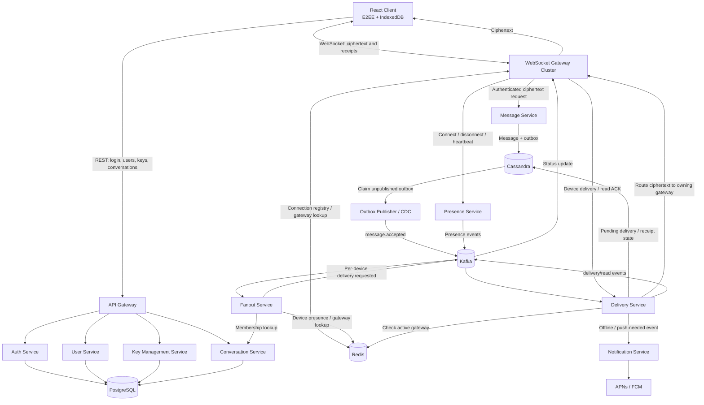
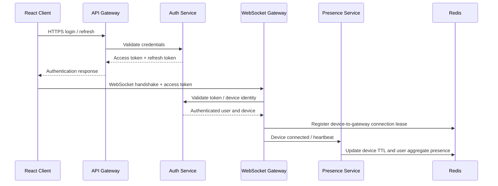
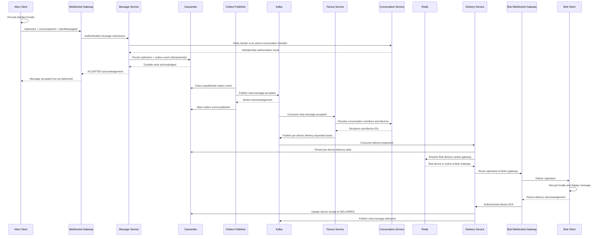
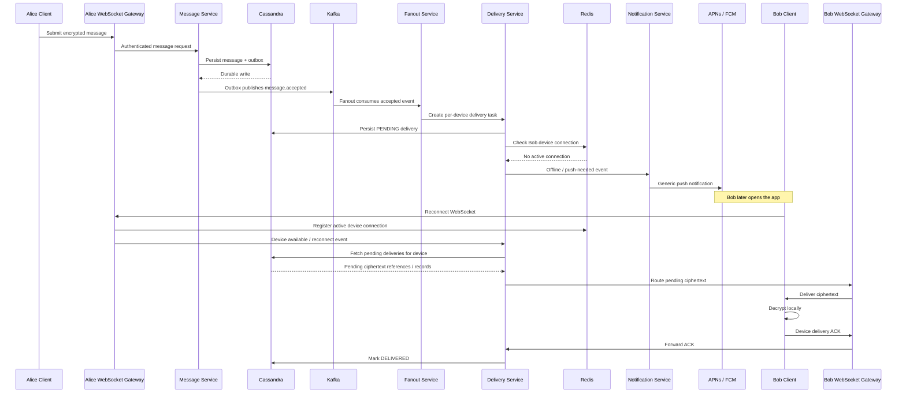
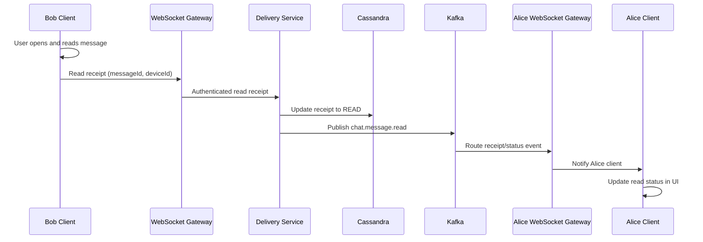
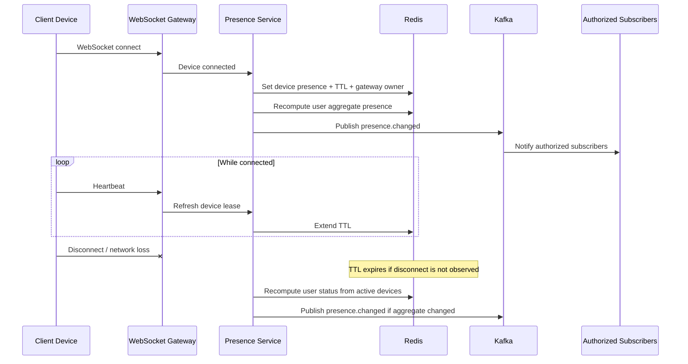
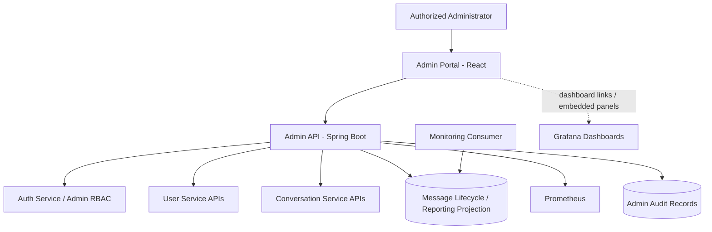
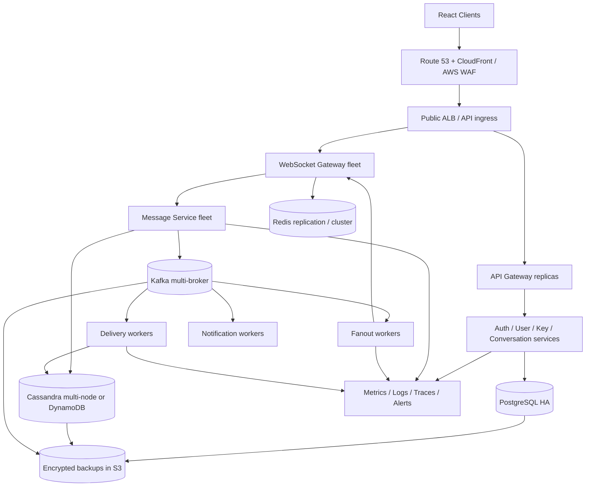

# SecureChat Architecture and Data Design

**Version:** 1.0
**Status:** Current MVP architecture (Chat System + Admin Portal). The feature roadmap is in §19; production deployment guidance (§20–26) is a set of recommendations for operators.

## 1. Scope boundaries: CURRENT MVP, roadmap and production recommendations

This document describes both the implementation target and the longer-term
architecture direction. The labels below are normative. A coding agent or
engineering team must not interpret future architecture as current scope.

| Capability                              | Scope                    | Implementation guidance                                                                                                                                |
| --------------------------------------- | ------------------------ | ------------------------------------------------------------------------------------------------------------------------------------------------------ |
| End-user chat application               | **CURRENT MVP**          | Implement registration/login, profiles/devices, one-to-one and group E2EE chat, WebSocket delivery, presence, offline sync, receipts, edit/delete, disappearing messages                |
| Admin Portal                            | **CURRENT MVP**          | Implement protected admin access, registered-user listing/search, operational dashboard, message trace lookup, basic reports, service health and audit |
| Basic observability                     | **CURRENT MVP**          | Health/readiness, structured logs, correlation/trace IDs, Micrometer/Prometheus metrics and starter Grafana dashboards                                 |
| Message lifecycle projection            | **CURRENT MVP**          | Consume lifecycle events and maintain operational status/reporting projection; no plaintext content                                                    |
| Near-term features                      | **NEAR-TERM**            | "Keep messages for…" auto-clear, reply/reactions, push, encrypted backup/recovery, privacy settings, invite links, QR device linking (§19.2) |
| Future improvements                     | **FUTURE**               | Photos/files, voice messages, encrypted calls, installable/mobile apps, on-device search, link previews (§19.3)                                   |
| Production-scale infrastructure         | **RECOMMENDATION**       | Multi-AZ, autoscaling, managed HA stores, SLOs, DR — guidance for operators in §20–26, not a product phase                                  |
| Kubernetes / active-active multi-region | **CONDITIONAL**          | Consider only after workload, operational maturity and consistency requirements justify them                                                           |

### MVP completion definition

The current MVP is complete when a user can register and use the chat system,
and an authorized administrator can sign in to the Admin Portal, see/search
registered users, inspect operational message lifecycle metadata, view basic
message/service reports, and review admin audit events.

The Admin Portal must never decrypt messages or expose plaintext, private keys
or session secrets. The roadmap (§19) and production recommendations (§20–26) are design direction only.

## 2. Architecture principles

1. Independent Spring Boot microservices with explicit ownership.
2. PostgreSQL for relational business data.
3. Cassandra for encrypted message and high-volume delivery data.
4. Redis for ephemeral presence and routing state.
5. Kafka for asynchronous event distribution.
6. WebSocket Gateway for persistent client connections.
7. Fanout Service for recipient and device distribution.
8. Client-only message encryption/decryption.
9. Durable message persistence before message acceptance.
10. At-least-once event publication with idempotent processing.

## 3. Logical architecture



## 4. Service responsibility and data ownership

| Service                         | Owns                                                                                                | Data store                                                                               | Must not do                                          |
| ------------------------------- | --------------------------------------------------------------------------------------------------- | ---------------------------------------------------------------------------------------- | ---------------------------------------------------- |
| API Gateway                     | Routing and gateway policy                                                                          | None; stateless                                                                          | Own business data                                    |
| WebSocket Gateway               | Live socket lifecycle and connection routing                                                        | Redis for connection metadata                                                            | Decrypt message payload                              |
| Auth Service                    | Credentials and refresh sessions                                                                    | PostgreSQL                                                                               | Own user profile or conversations                    |
| User Service                    | Profiles, devices and contacts                                                                      | PostgreSQL                                                                               | Store device private keys                            |
| Key Management Service          | Public keys and prekey inventory                                                                    | PostgreSQL                                                                               | Store private identity or session keys               |
| Conversation Service            | Conversation and membership state                                                                   | PostgreSQL                                                                               | Store message bodies                                 |
| Message Service                 | Message persistence and outbox                                                                      | Cassandra                                                                                | Decrypt message payload                              |
| Fanout Service                  | Routing decisions and delivery task creation                                                        | Redis cache; Kafka events; service APIs                                                  | Store canonical conversation data                    |
| Presence Service                | User/device presence                                                                                | Redis                                                                                    | Treat presence as durable business data              |
| Delivery Service                | Per-device delivery workflow                                                                        | Cassandra                                                                                | Mark delivered without device acknowledgement        |
| Notification Service            | Push notification workflow                                                                          | No dedicated store initially; optional PostgreSQL for durable preferences/jobs           | Include plaintext message content in push payload    |
| Admin API / Admin Service       | Admin RBAC, controlled operational APIs, user listing/search, report access and admin audit         | PostgreSQL for admin roles/audit metadata; reads through owning service APIs/projections | Bypass service ownership or expose message plaintext |
| Monitoring Consumer / Reporting | Consume lifecycle events, deduplicate them, maintain message trace projection and aggregate reports | PostgreSQL initially; future analytical store only when needed                           | Become a synchronous dependency of message delivery  |

A shared PostgreSQL cluster is acceptable for the MVP, but use separate
databases or schemas, dedicated credentials, and strict ownership. A
service must not directly read or write another service's tables.

## 5. Data placement: what is saved where?

### PostgreSQL --- relational and transactional business data

| Data                                        | Table                       | Owner          |
| ------------------------------------------- | --------------------------- | -------------- |
| User login identity                         | `users`                     | Auth           |
| Password hash                               | `credentials`               | Auth           |
| Refresh token hash and expiry               | `refresh_tokens`            | Auth           |
| User profile                                | `user_profiles`             | User           |
| Registered device metadata                  | `devices`                   | User           |
| Contacts                                    | `contacts`                  | User           |
| Public identity key                         | `identity_keys`             | Key Management |
| Signed prekey public material and signature | `signed_prekeys`            | Key Management |
| One-time prekey inventory and claim state   | `one_time_prekey_inventory` | Key Management |
| Conversation metadata                       | `conversations`             | Conversation   |
| Conversation membership                     | `conversation_members`      | Conversation   |
| Group metadata/settings                     | `group_metadata`            | Conversation   |

Do not store plaintext messages, private identity keys, private session
keys, or raw passwords in PostgreSQL.

### Cassandra --- high-volume message and delivery data

| Data                                                  | Table                         | Owner    |
| ----------------------------------------------------- | ----------------------------- | -------- |
| Encrypted message history                             | `messages_by_conversation`    | Message  |
| Pending message delivery per device                   | `pending_messages_by_device`  | Delivery |
| Per-message recipient receipts                        | `message_receipts_by_message` | Delivery |
| Durable outbox events (if polling outbox is selected) | `message_outbox_by_bucket`    | Message  |

Cassandra stores ciphertext, message identifiers, timestamps,
sender/device identifiers, conversation identifiers, protocol version,
and delivery metadata. These metadata are still sensitive and should be
protected by access controls and retention policies.

### Redis --- ephemeral and rebuildable state

| Data                       | Suggested key                           | Owner              |
| -------------------------- | --------------------------------------- | ------------------ |
| User presence summary      | `presence:user:{userId}`                | Presence           |
| Device presence            | `presence:device:{deviceId}`            | Presence           |
| Device connection owner    | `connection:device:{deviceId}`          | WebSocket/Presence |
| Gateway connection set     | `gateway:{gatewayId}:connections`       | WebSocket          |
| Heartbeat expiry           | TTL on device presence key              | Presence           |
| Typing indicator           | `typing:{conversationId}:{userId}`      | Presence/Chat      |
| Recipient membership cache | `conversation:{conversationId}:members` | Fanout cache       |

Redis is not the authoritative message store. Presence and connection
state must be reconstructable after Redis restart. Use TTLs and atomic
operations/Lua scripts for concurrent device connection updates.

### Kafka --- event transport, not primary storage

Suggested topics:

- `chat.message.accepted`
- `chat.message.fanout.requested`
- `chat.message.delivery.requested`
- `chat.message.delivered`
- `chat.message.read`
- `chat.message.failed`
- `chat.presence.online`
- `chat.presence.offline`
- `chat.presence.changed`
- `chat.device.connected`
- `chat.device.disconnected`
- `chat.conversation.created`
- `chat.group.member.added`
- `chat.group.member.removed`

Events carry identifiers, event type/version, timestamp, correlation ID,
and the minimum required payload. Do not put private keys or plaintext
messages in Kafka. Prefer ciphertext references plus message identifiers
when consumers can retrieve ciphertext through an authorized service
API; if ciphertext is carried in events, document the exposure and
retention implications.

## 6. PostgreSQL schema design

These are logical starting schemas. Use Flyway or Liquibase migrations.
Add foreign keys and indexes within each service-owned database.
Cross-service IDs are UUID references, not cross-database foreign keys.

### 6.1 Auth Service

```sql
CREATE TABLE users (
    id UUID PRIMARY KEY,
    email VARCHAR(320) NOT NULL UNIQUE,
    username VARCHAR(64) NOT NULL UNIQUE,
    status VARCHAR(20) NOT NULL DEFAULT 'ACTIVE',
    created_at TIMESTAMPTZ NOT NULL DEFAULT NOW(),
    updated_at TIMESTAMPTZ NOT NULL DEFAULT NOW()
);

CREATE TABLE credentials (
    user_id UUID PRIMARY KEY REFERENCES users(id),
    password_hash TEXT NOT NULL,
    password_updated_at TIMESTAMPTZ NOT NULL DEFAULT NOW()
);

CREATE TABLE refresh_tokens (
    id UUID PRIMARY KEY,
    user_id UUID NOT NULL REFERENCES users(id),
    token_hash TEXT NOT NULL UNIQUE,
    expires_at TIMESTAMPTZ NOT NULL,
    revoked_at TIMESTAMPTZ,
    created_at TIMESTAMPTZ NOT NULL DEFAULT NOW()
);

CREATE INDEX idx_refresh_tokens_user
    ON refresh_tokens(user_id);
```

Never store raw passwords or raw refresh tokens. Use Argon2id for
password hashing where supported.

Account self-service (CURRENT MVP, auth-service, authenticated user only):

| Endpoint | Purpose | Rules |
|---|---|---|
| `GET /api/v1/auth/account` | own user id, username, **email** | email is never part of public profiles |
| `PUT /api/v1/auth/account/email` | change email | current password required; validated, unique, lower-cased; rate-limited like login |
| `PUT /api/v1/auth/account/password` | change password | current password required; ≥ 10 chars, not containing the username, different; **all other sessions revoked** (`PASSWORD_CHANGED`) |

Login throttling: per username 10 attempts / 5 min and per IP 50 / 5 min (in-process sliding window),
plus the gateway's Redis limiter. There is no permanent lockout for end-user accounts; admins can suspend.

### 6.2 User Service

```sql
CREATE TABLE user_profiles (
    user_id UUID PRIMARY KEY,
    display_name VARCHAR(100) NOT NULL,
    avatar_url TEXT,
    bio TEXT,
    created_at TIMESTAMPTZ NOT NULL DEFAULT NOW(),
    updated_at TIMESTAMPTZ NOT NULL DEFAULT NOW()
);

CREATE TABLE devices (
    id UUID PRIMARY KEY,
    user_id UUID NOT NULL,
    device_name VARCHAR(100),
    device_type VARCHAR(30),
    platform VARCHAR(40),
    status VARCHAR(20) NOT NULL DEFAULT 'ACTIVE',   -- ACTIVE | REVOKED
    created_at TIMESTAMPTZ NOT NULL DEFAULT NOW(),
    revoked_at TIMESTAMPTZ,
    last_authenticated_at TIMESTAMPTZ,
    removed_at TIMESTAMPTZ          -- owner removed it from their list (row kept: the id can never be reused)
);

-- Device-to-device history sync relay (ciphertext only; see the key-management document §10.2)
CREATE TABLE device_transfers (
    id UUID PRIMARY KEY,
    user_id UUID NOT NULL,
    target_device_id UUID NOT NULL,      -- requesting (new) device
    source_device_id UUID,               -- device that answered (compare-and-set)
    ephemeral_public_key TEXT NOT NULL,
    request_signature TEXT NOT NULL,     -- binds user, device, window and key
    status VARCHAR(12) NOT NULL,         -- REQUESTED | APPROVED | READY | DECLINED | COMPLETED | EXPIRED
    manifest TEXT, manifest_signature TEXT, total_bytes BIGINT, chunk_count INT,
    window_from TIMESTAMPTZ, window_to TIMESTAMPTZ,   -- ≤ 31 days
    created_at TIMESTAMPTZ, updated_at TIMESTAMPTZ, expires_at TIMESTAMPTZ NOT NULL
);
CREATE TABLE device_transfer_chunks (transfer_id UUID, seq INT, data BYTEA, PRIMARY KEY (transfer_id, seq));

CREATE INDEX idx_devices_user
    ON devices(user_id);

CREATE TABLE contacts (
    owner_user_id UUID NOT NULL,
    contact_user_id UUID NOT NULL,
    created_at TIMESTAMPTZ NOT NULL DEFAULT NOW(),
    PRIMARY KEY (owner_user_id, contact_user_id)
);
```

`devices.user_id` refers to the Auth Service user ID. Enforce
consistency through service APIs/events because service databases are
independently owned.

Owner device actions: **Revoke** (`DELETE /api/v1/devices/{id}`: signs the device out for good, stops new
messages, stays listed as REVOKED) and **Remove** (`POST /api/v1/devices/{id}/remove`: revokes if still active,
then hides it from the owner's list). Both emit one `chat.device.revoked` event. Admins see all devices.

### 6.3 Key Management Service

```sql
CREATE TABLE identity_keys (
    id UUID PRIMARY KEY,
    device_id UUID NOT NULL,
    public_key BYTEA NOT NULL,
    algorithm VARCHAR(80) NOT NULL,
    key_version INTEGER NOT NULL,
    created_at TIMESTAMPTZ NOT NULL DEFAULT NOW(),
    revoked_at TIMESTAMPTZ,
    UNIQUE (device_id, key_version)
);

CREATE TABLE signed_prekeys (
    id UUID PRIMARY KEY,
    device_id UUID NOT NULL,
    key_id BIGINT NOT NULL,
    public_key BYTEA NOT NULL,
    signature BYTEA NOT NULL,
    algorithm VARCHAR(80) NOT NULL,
    created_at TIMESTAMPTZ NOT NULL DEFAULT NOW(),
    expires_at TIMESTAMPTZ,
    UNIQUE (device_id, key_id)
);

CREATE TABLE one_time_prekey_inventory (
    id UUID PRIMARY KEY,
    device_id UUID NOT NULL,
    key_id BIGINT NOT NULL,
    public_key BYTEA NOT NULL,
    status VARCHAR(20) NOT NULL DEFAULT 'AVAILABLE',
    claimed_at TIMESTAMPTZ,
    created_at TIMESTAMPTZ NOT NULL DEFAULT NOW(),
    UNIQUE (device_id, key_id)
);

CREATE INDEX idx_prekeys_available
    ON one_time_prekey_inventory(device_id, status);
```

Use an atomic claim operation/transaction for one-time prekeys. Never
persist private keys. The exact key format and lifecycle must match the
selected cryptographic library.

### 6.4 Conversation Service

```sql
CREATE TABLE conversations (
    id UUID PRIMARY KEY,
    conversation_type VARCHAR(20) NOT NULL,
    display_name VARCHAR(150),
    created_by UUID NOT NULL,
    status VARCHAR(20) NOT NULL DEFAULT 'ACTIVE',
    disappearing_seconds INT,                       -- disappearing-messages timer; NULL = off (V4)
    created_at TIMESTAMPTZ NOT NULL DEFAULT NOW(),
    updated_at TIMESTAMPTZ NOT NULL DEFAULT NOW(),
    CHECK (conversation_type IN ('DIRECT', 'GROUP'))
);

CREATE TABLE conversation_members (
    conversation_id UUID NOT NULL REFERENCES conversations(id),
    user_id UUID NOT NULL,
    role VARCHAR(20) NOT NULL DEFAULT 'MEMBER',   -- OWNER | ADMIN | MEMBER
    joined_at TIMESTAMPTZ NOT NULL DEFAULT NOW(),
    left_at TIMESTAMPTZ,
    joined_epoch BIGINT NOT NULL DEFAULT 0,        -- first MLS epoch the member can read
    PRIMARY KEY (conversation_id, user_id)
);

CREATE INDEX idx_conversation_members_user
    ON conversation_members(user_id);

CREATE TABLE group_metadata (
    conversation_id UUID PRIMARY KEY REFERENCES conversations(id),
    group_description TEXT,
    avatar_url TEXT,
    group_version BIGINT NOT NULL DEFAULT 1,
    mls_group_id VARCHAR(64) NOT NULL UNIQUE,
    epoch BIGINT NOT NULL DEFAULT 0,               -- MLS epoch; commits are compare-and-set on it
    updated_at TIMESTAMPTZ NOT NULL DEFAULT NOW()
);

-- MLS commit log (epoch N → N+1) and per-device Welcomes: opaque protocol messages
CREATE TABLE mls_commits (conversation_id UUID, epoch BIGINT, commit_message BYTEA, sender_user_id UUID,
    sender_device_id UUID, kind VARCHAR(20), created_at TIMESTAMPTZ, PRIMARY KEY (conversation_id, epoch));
-- kind: ADD_MEMBERS | REMOVE_MEMBER | DEVICE_SYNC | UPDATE

-- Group history for new members (key-management document §10.3)
CREATE TABLE history_grants (               -- an OWNER/ADMIN authorises a scope at invite
    id UUID PRIMARY KEY, conversation_id UUID NOT NULL, granted_by_user UUID NOT NULL,
    scope VARCHAR(20) NOT NULL,             -- last100 | 10m | 1h | 10h | 1d | 7d | 30d | all
    created_at TIMESTAMPTZ, expires_at TIMESTAMPTZ NOT NULL,   -- 7 days
    claimed_by_user UUID, claimed_by_device UUID, claimed_at TIMESTAMPTZ,   -- first member to claim
    share_id UUID REFERENCES history_shares(id)
);
CREATE TABLE history_shares (               -- ciphertext uploaded by the claiming device
    id UUID PRIMARY KEY, conversation_id UUID NOT NULL, created_by_user UUID NOT NULL,
    created_by_device UUID NOT NULL, status VARCHAR(20) NOT NULL,   -- UPLOADING | READY
    chunk_count INT, total_bytes BIGINT, created_at TIMESTAMPTZ, expires_at TIMESTAMPTZ NOT NULL   -- 30 days
);
CREATE TABLE history_share_chunks (share_id UUID, seq INT, data BYTEA, PRIMARY KEY (share_id, seq));
```

### 6.5 Group roles and access rights (CURRENT MVP)

Enforced by conversation-service on every request (the UI only hides what the server would refuse).

| Action | OWNER | ADMIN | MEMBER | Endpoint |
|---|---|---|---|---|
| Send / read messages | ✅ | ✅ | ✅ | message-service (membership authorised per send) |
| Invite members | ✅ as Admin **or** Member | ✅ as **Member only** | ❌ | `POST /groups/{id}/members {userIds, role, commit, welcomes}` |
| Share earlier history with invitees (grant) | ✅ | ✅ | ❌ | `POST /groups/{id}/history-grants {scope}` |
| Fulfil a history grant from own device | ✅ | ✅ | ✅ | `POST /groups/{id}/history-grants/{gid}/claim` |
| Remove a member | ✅ | ✅ | ❌ | `DELETE /groups/{id}/members/{userId}` |
| Remove an admin | ✅ | ❌ | ❌ | same |
| Remove the owner | ❌ | ❌ | ❌ | — |
| Promote / demote (ADMIN ⇄ MEMBER) | ✅ | ❌ | ❌ | `PUT /groups/{id}/members/{userId}/role` |
| Edit group name / description | ✅ | ✅ | ❌ | `PATCH /groups/{id}` (metadata, not E2EE) |
| Rotate group keys (MLS update commit) | ✅ | ✅ | ✅ | `POST /groups/{id}/commits {kind: UPDATE}` |
| Leave | ✅ (ownership passes to an admin, else a member) | ✅ | ✅ | `POST /groups/{id}/leave` |

Exactly one OWNER per group (the creator). Invitees join as MEMBER unless the owner chooses ADMIN. Role
checks for an invite happen before the MLS commit is stored, so a refused invite changes nothing.

For direct conversations, implement a deterministic participant-pair
uniqueness strategy so two concurrent requests do not create duplicate
direct conversations. For example, store normalized participant IDs in a
separate direct-conversation mapping table with a unique constraint.

## 7. Cassandra schema design

Cassandra tables must be designed from query patterns. These examples
are starting points and must be validated against expected traffic,
partition size, retention, and pagination.

### 7.1 Messages by conversation and time bucket

```sql
CREATE TABLE messages_by_conversation (
    conversation_id UUID,
    bucket_date DATE,
    created_at TIMESTAMP,
    message_id UUID,
    sender_id UUID,
    sender_device_id UUID,
    ciphertext BLOB,
    encryption_protocol TEXT,
    message_type TEXT,
    client_message_id UUID,
    PRIMARY KEY (
        (conversation_id, bucket_date),
        created_at,
        message_id
    )
) WITH CLUSTERING ORDER BY (
    created_at DESC,
    message_id ASC
);
```

Access pattern: fetch latest messages for one conversation and one time
bucket, then paginate backward using a clustering-key cursor. Use a
bounded bucket such as a day or another interval selected from expected
conversation volume.

Retention and deletion:

- Table default TTL is 365 days. A message sent while a chat has a
  disappearing-messages timer is written `USING TTL <expiresInSeconds>`
  (300 … 2 592 000 s), so Cassandra drops its ciphertext on time.
- **Delete for everyone** (`DELETE /api/v1/conversations/{id}/messages/{messageId}?at=<createdAt>`)
  deletes the row by its full primary key. message-service allows it only for the
  original sender, a current member, within 24 hours (`409 DELETE_WINDOW_EXPIRED`).
  Recipients hide the message through an encrypted `delete` notice; the server
  cannot read or verify which message text was deleted.

### 7.2 Pending delivery by device and time bucket

```sql
CREATE TABLE pending_messages_by_device (
    recipient_device_id UUID,
    bucket_date DATE,
    created_at TIMESTAMP,
    message_id UUID,
    conversation_id UUID,
    ciphertext BLOB,
    PRIMARY KEY (
        (recipient_device_id, bucket_date),
        created_at,
        message_id
    )
) WITH CLUSTERING ORDER BY (
    created_at ASC,
    message_id ASC
);
```

Access pattern: retrieve pending messages for a device across relevant
buckets. Define retention, acknowledgement deletion/marking, and
pagination. Avoid an unbounded partition per device.

### 7.3 Receipts by message

```sql
CREATE TABLE message_receipts_by_message (
    message_id UUID,
    recipient_device_id UUID,
    status TEXT,
    updated_at TIMESTAMP,
    PRIMARY KEY ((message_id), recipient_device_id)
);
```

Access pattern: retrieve per-device delivery/read state for one message.
If a message can have very large recipient counts, reassess
partitioning.

### 7.4 Idempotency record

Create a queryable deduplication table keyed by the sender/device and
client message ID, with a bounded time bucket and expiry policy. Define
how the service resolves a retry to the original message ID. Avoid
relying solely on a process-local cache.

## 8. Cassandra and Kafka reliability

### 8.1 The dual-write problem

The Message Service performs two independent operations:

1. Persist ciphertext in Cassandra.
2. Publish `chat.message.accepted` to Kafka.

Possible failure: Cassandra succeeds, Kafka fails. The message exists
but Fanout never learns about it.

Possible crash: Kafka acknowledges publication, then the publisher
crashes before marking the event published. The event may be published
again after restart.

### 8.2 MVP approach: Cassandra outbox

Persist the message and outbox event in the same Cassandra partition and
in a logged batch where the schema supports same-partition atomicity.

A sample logical outbox table:

```sql
CREATE TABLE message_outbox_by_bucket (
    bucket_date DATE,
    shard INT,
    created_at TIMESTAMP,
    event_id UUID,
    message_id UUID,
    event_type TEXT,
    payload BLOB,
    status TEXT,
    attempt_count INT,
    next_attempt_at TIMESTAMP,
    PRIMARY KEY (
        (bucket_date, shard),
        created_at,
        event_id
    )
) WITH CLUSTERING ORDER BY (
    created_at ASC,
    event_id ASC
);
```

Important implementation constraints:

- Message and outbox records must be in the same partition for the
  intended atomic batch guarantee.
- Do not use cross-partition batches as a substitute for a relational
  transaction.
- Define bounded time buckets and shards.
- Define safe publisher claiming/lease logic for multiple publisher
  instances.
- Define how published status is updated and how stale leases recover.
- Retain unpublished events until successfully published or explicitly
  quarantined.
- Make consumers idempotent.
- Do not claim exactly-once delivery.

### 8.3 Publisher flow

1. Read eligible unpublished outbox events.
2. Claim a bounded batch using a safe lease/claim strategy.
3. Publish to Kafka with `acks=all` and producer idempotence enabled.
4. Wait for broker acknowledgement.
5. Mark the outbox event as published.
6. On failure, release or allow lease expiry and retry with exponential
   backoff.
7. After a configured retry threshold, alert and move to a monitored
   recovery workflow; do not silently discard.

There is still a duplicate window between Kafka acknowledgement and
marking the outbox row published. Consumer idempotency is mandatory.

### 8.4 CDC alternative

Evaluate Cassandra CDC with a compatible connector or custom publisher.
Document CDC log capacity, retention, connector offsets, backlog
monitoring, restart/recovery, duplicate events, and operational
ownership.

Do not enable CDC without a defined consumer and retention plan.

### 8.5 Kafka producer settings

Example starting configuration:

```properties
spring.kafka.producer.acks=all
spring.kafka.producer.enable-idempotence=true
spring.kafka.producer.retries=10
```

Set Kafka replication factor and minimum in-sync replicas according to
actual broker count. A single local broker cannot provide replicated
durability.

## 9. Message state semantics

Define distinct states:

- `RECEIVED`: backend received the request.
- `PERSISTED`: ciphertext is durably written to Cassandra.
- `ACCEPTED`: required durable event/outbox record exists and the
  service has accepted responsibility.
- `PUBLISHED`: Kafka acknowledged the event.
- `DELIVERED`: recipient device acknowledged receipt.
- `READ`: recipient device sent a read acknowledgement.
- `FAILED`: a terminal or explicitly surfaced failure state.

The API acknowledgement contract must state whether it means `PERSISTED`
or `ACCEPTED`. Do not report `DELIVERED` based solely on a WebSocket
send call.

## 10. End-to-end message flow

This section describes the complete lifecycle for one-to-one and group
messages, including online delivery, offline storage, acknowledgements,
presence, and push notifications.

### 10.1 Connection and authentication setup



- REST calls (login, profile, key bundle retrieval, conversation creation)
  use API Gateway.
- The client opens a persistent WebSocket connection for real-time
  messaging.
- Each connection is associated with an authenticated user and device.
- WebSocket Gateway registers the connection owner and a lease/TTL in
  Redis. Redis records live routing state; it is not a durable mailbox.
- Presence is device-derived: a user is online when at least one eligible
  device connection is active.

### 10.2 Alice sends a message to Bob (Bob online)

Assumptions: Alice and Bob have completed the E2EE key/session setup;
Bob has at least one active device connection.



Detailed responsibilities:

1. **Client encryption:** Alice's React client encrypts the plaintext
   locally using the E2EE session. The backend receives ciphertext and
   routing metadata only.
2. **WebSocket ingress:** WebSocket Gateway authenticates the connection
   and forwards the ciphertext request to Message Service.
3. **Authorization:** Message Service verifies sender/device status and
   conversation membership through authoritative Conversation Service
   data or a safely validated authorization mechanism. Do not trust a
   client-supplied conversation ID by itself.
4. **Durable persistence:** Message Service writes the ciphertext and
   its outbox event to Cassandra using the selected atomicity strategy.
   It returns acceptance only after the required durable write succeeds.
5. **Outbox publication:** Outbox Publisher claims unpublished records,
   publishes to Kafka, waits for broker acknowledgement, then marks the
   outbox record published. A crash can cause duplicate publication;
   consumers must be idempotent.
6. **Recipient resolution:** Fanout consumes the accepted event, resolves
   current conversation members and their active devices, and creates
   deterministic per-device delivery tasks.
7. **Delivery ownership:** Delivery Service owns the durable per-device
   delivery state. It persists or upserts the task before attempting
   delivery so a crash does not lose the work.
8. **Gateway routing:** Delivery Service uses Redis to discover which
   gateway owns the recipient device. Redis is a lookup/control-plane
   mechanism, not the message transport itself. The actual route uses
   an internal gateway channel such as Redis Pub/Sub, an internal
   messaging channel, or a gateway-routing service.
9. **Recipient receipt:** Bob decrypts on his client and sends a
   device-level acknowledgement. Delivery Service records `DELIVERED`
   and publishes a receipt event so Alice's client can update its UI.

### 10.3 Bob is offline

If Fanout or Delivery Service cannot find an active device connection:

1. Fanout still creates a delivery task for each eligible Bob device.
2. Delivery Service persists the pending delivery record in Cassandra.
3. The message remains available for later delivery; it is not held only
   in Redis or Kafka.
4. Notification Service may send a generic push notification through
   APNs or FCM, subject to user preferences and device token validity.
5. The push must not include plaintext message content. It can say that
   a new message is available and prompt the app to connect.
6. When Bob reconnects, the gateway registers the device in Redis and
   notifies Delivery Service that the device is available.
7. Delivery Service queries pending records for that device and routes
   ciphertext through the owning WebSocket Gateway.
8. Bob decrypts locally and acknowledges. Delivery Service marks the
   record delivered and suppresses subsequent retries.



**Key distinction:** Redis answers "where is this device connected
right now?" Cassandra answers "which messages still need to be delivered
to this device?" Kafka transports work/events between services. None of
these roles should be conflated.

### 10.4 Group message flow

For a group conversation, the ingress and persistence flow is the same
as one-to-one messaging, but Fanout resolves all eligible group members
and their registered devices.

1. Sender encrypts the group message on the client using the selected
   group E2EE protocol (for example, a supported Sender Keys design or
   MLS implementation).
2. Message Service authorizes the sender against current group
   membership and persists ciphertext plus outbox.
3. Fanout resolves the conversation's active member set and devices.
4. Fanout creates one deterministic delivery task per eligible device.
5. Delivery Service routes to online devices and persists pending work
   for offline devices.
6. Each recipient device acknowledges independently. One user's device
   receipt must not imply that all devices or all group members received
   the message.

Group membership changes must invalidate membership caches. Member
removal must trigger the protocol-required group key rotation so the
removed member cannot decrypt future messages. Do not use stale cached
membership to authorize sends or deliveries after a membership change.

CURRENT MVP specifics (details in the key-management document §9.5 and §10):

- Groups use **MLS**; every membership or device change is a commit to a new epoch, ordered by
  conversation-service with an epoch compare-and-set. Any member can also **rotate group keys** manually.
- A new member reads from their join epoch only. If the inviting OWNER/ADMIN granted a history scope, a
  member device that holds that history re-encrypts it (AES-256-GCM, fresh key), uploads ciphertext to
  conversation-service and sends the key in the MLS epoch; otherwise the member sees *"You can't see
  messages from before you joined"*.
- A user's new device gets the last month automatically from the user's other devices (user-service relay,
  HPKE); **Load older messages** pages one month per click and fetches unreadable months the same way.

### 10.5 Read receipts and sender status updates



Delivery and read states are different:

- `ACCEPTED`: server has accepted responsibility after durable
  persistence/outbox requirements succeed.
- `PUBLISHED`: Kafka acknowledged event publication.
- `DELIVERED`: a recipient device acknowledged receipt.
- `READ`: a recipient device explicitly reported that the message was
  read, according to product receipt policy.

A WebSocket send call alone is not proof of delivery or reading.

### 10.6 Presence lifecycle



- Presence is calculated across all active devices. One device
  disconnecting does not mark the user offline if another remains active.
- Use TTL/leases and atomic Redis operations or Lua scripts to avoid
  concurrent connect/disconnect races.
- If Redis is unavailable, presence becomes unknown/degraded; do not
  infer that all users are offline.
- Rebuild live presence from reconnects and heartbeats after Redis
  recovery.

### 10.7 Service responsibilities in the message lifecycle

| Component            | Responsibility in the flow                                      | Owns durable state?                            |
| -------------------- | --------------------------------------------------------------- | ---------------------------------------------- |
| React Client         | Encrypt/decrypt; hold client keys; send message and receipts    | Client-side keys/session state                 |
| API Gateway          | REST authentication, routing and rate limiting                  | No                                             |
| WebSocket Gateway    | Authenticate sockets and transport ciphertext/receipts          | No; Redis connection lease is ephemeral        |
| Message Service      | Validate, authorize and persist new message plus outbox         | Message record in Cassandra                    |
| Outbox Publisher     | Publish durable outbox events to Kafka and mark publication     | Outbox record is owned by Message Service      |
| Fanout Service       | Resolve conversation members/devices and create delivery tasks  | No canonical conversation or message ownership |
| Delivery Service     | Persist per-device pending state, retry, ACK and read lifecycle | Delivery state in Cassandra                    |
| Presence Service     | Compute online status and publish presence changes              | Redis ephemeral state                          |
| Notification Service | Send generic push for offline recipients                        | Optional durable notification jobs/preferences |
| Conversation Service | Authoritative conversation membership and group metadata        | PostgreSQL                                     |
| Redis                | Live presence and gateway/device routing lookup                 | Ephemeral/rebuildable                          |
| Kafka                | Asynchronous event transport                                    | Retained event log, not the message mailbox    |

### 10.8 Important routing and reliability rules

- Redis connection mapping tells the system which gateway owns a device;
  it does not itself deliver a message to that gateway. Use an explicit
  internal gateway-routing transport.
- Persist per-device delivery work before attempting the network send.
- Use stable `messageId`, `eventId` and `deliveryId` values so retries
  and duplicate Kafka events are idempotent.
- A recipient may have multiple devices. Track delivery independently
  per device and define how the UI aggregates device receipts into a
  user-level status.
- Define sender-device echo policy explicitly: whether to sync the
  message to the sender's other devices and how the originating device
  is excluded.
- Do not use Kafka retention as the only offline-message store.
- If membership, device revocation or authorization data is unavailable
  or stale, fail closed for security-sensitive operations.

## 11. Presence and multi-device model

Presence is device-derived.

- A user may have multiple active devices.
- Each device connection has an expiry/heartbeat.
- A user is online if at least one eligible device connection is
  active.
- Closing one tab/device must not mark the user offline if another
  device remains connected.
- Redis state is ephemeral and rebuildable.
- Gateway crash recovery must remove stale mappings through TTL and
  reconciliation.

Use atomic Redis operations or Lua scripts to avoid races when multiple
devices connect/disconnect concurrently.

Suggested lifecycle:

1. WebSocket handshake authenticates device.
2. Gateway registers connection ownership.
3. Presence updates device heartbeat TTL.
4. Presence service computes user aggregate status.
5. Presence event is published to Kafka.
6. Authorized subscribers receive status updates.

## 12. Fanout and delivery model

### Fanout Service

1. Consume `chat.message.accepted`.
2. Resolve the authoritative conversation members through Conversation
   Service or a versioned cache with event-driven invalidation.
3. Resolve each eligible user's registered devices.
4. Apply sender-device echo and device-revocation policy.
5. Create a deterministic delivery task for each eligible recipient
   device and publish `chat.message.delivery.requested`.
6. Do not own canonical conversation membership or durable delivery
   receipt state.

### Delivery Service

1. Consume per-device `chat.message.delivery.requested` tasks.
2. Idempotently persist/upsert the pending delivery record in Cassandra
   before attempting network delivery.
3. Check Redis for the device's active connection and gateway owner.
4. If online, route ciphertext through an explicit internal gateway
   transport; Redis lookup alone does not transport the payload.
5. If offline, retain the pending delivery record and optionally emit
   an event for Notification Service to send a generic push.
6. On device acknowledgement, update the per-device state and publish
   the corresponding delivered event.
7. On read acknowledgement, update the read receipt and publish the
   corresponding read event.
8. Retry transient failures with bounded exponential backoff and jitter.
9. On reconnect, fetch and replay pending deliveries for that device.
10. Suppress duplicate sends/receipts through stable delivery IDs and
    idempotent state transitions.

### Multi-device and group semantics

- A user can have several registered devices; delivery is tracked per
  device, not merely per user.
- A user-level UI status is an aggregation policy over device receipts;
  define whether one device acknowledgement is enough to show
  "delivered" to that user.
- Group fanout creates per-device delivery tasks for each eligible
  member. A receipt from one member does not imply delivery to the
  whole group.
- Group membership changes invalidate membership caches and must be
  applied before subsequent authorization-sensitive fanout.
- Removed members must not receive future group messages and group
  cryptographic keys must be rotated according to the selected E2EE
  protocol.

## 13. Failure and recovery matrix

| Failure scenario                            | Expected behaviour                                                                            | Recovery action                                                                                  |
| ------------------------------------------- | --------------------------------------------------------------------------------------------- | ------------------------------------------------------------------------------------------------ |
| Cassandra unavailable before write          | Do not accept the message as durably persisted                                                | Client retries with the same idempotency key                                                     |
| Cassandra write succeeds, Kafka unavailable | Outbox event remains pending                                                                  | Publisher retries until Kafka acknowledges publication                                           |
| Publisher crashes after Kafka ACK           | Event may be published more than once                                                         | Consumers deduplicate using stable event/message IDs                                             |
| Fanout Service unavailable                  | Kafka event remains unprocessed or retryable                                                  | Consumer resumes processing after recovery                                                       |
| Delivery Service unavailable                | Durable pending-delivery state remains available                                              | Retry delivery after service restart                                                             |
| Redis unavailable                           | Presence becomes unknown/degraded; do not mark everyone offline                               | Restore Redis and rebuild live state from gateway reconnects and heartbeats                      |
| WebSocket Gateway crashes                   | Clients reconnect to another healthy gateway                                                  | Expire stale connection leases and replay pending messages                                       |
| PostgreSQL unavailable                      | Do not bypass authorization or membership checks using unsafe stale data                      | Restore/fail over PostgreSQL; resume protected operations after consistency checks               |
| Cassandra node restarts                     | Driver retries eligible operations safely                                                     | Verify node health, consistency and repair/restore status                                        |
| Kafka broker unavailable                    | Do not report successful event publication without broker acknowledgement                     | Outbox retains unpublished events; retry after broker recovery                                   |
| Full host restart                           | Persistent volumes preserve durable data, but single-host availability is lost during restart | Start dependencies in readiness order; verify database and broker health before enabling traffic |

Use exponential backoff with jitter, bounded retries, timeouts, circuit
breakers where appropriate, and dead-letter/recovery queues with
alerting.

## 14. API and event contract rules

- REST APIs must be versioned.
- OpenAPI specifications must be generated.
- Kafka events must have event version and schema compatibility rules.
- Every request/event should carry correlation ID.
- Every client message must carry an idempotency/client message ID.
- Every Kafka event must have a stable event ID.
- Validate authorization at the service owning the resource.
- Never trust user IDs supplied by the client without token and
  ownership validation.

## 15. Observability

Metrics to expose:

- Cassandra write latency and failures.
- Outbox pending count and oldest pending age.
- Outbox publish successes/failures.
- Kafka producer errors and consumer lag.
- Fanout latency and recipient count.
- Delivery pending count and retry count.
- Active WebSocket connections.
- Presence heartbeat expiry.
- Redis latency/errors.
- Message acceptance-to-delivery latency.

Use structured JSON logs, OpenTelemetry trace IDs, Prometheus metrics,
Grafana dashboards, and Jaeger traces. Never log plaintext or private
keys.

## 16. Local and EC2 deployment

### Local Compose

Containers:

- React frontend
- API Gateway
- WebSocket Gateway
- Auth Service
- User Service
- Key Management Service
- Conversation Service
- Message Service
- Fanout Service
- Presence Service
- Delivery Service
- Notification Service
- PostgreSQL
- Cassandra
- Redis
- Kafka in KRaft mode
- Kafka UI (development only)
- Nginx
- Optional Prometheus/Grafana/Jaeger

Use persistent volumes, internal Docker networks, health checks,
environment variables, and startup readiness checks.

Frontend runtime settings: the frontend container (nginx) serves `/config.json`, generated at start-up from
its environment (only `SECURECHAT_*` variables are substituted into the nginx template). Today it carries one
switch, `ONBOARDING_ENABLED` in `.env` → `{"onboarding":"true|false"}`, read by the client to enable or hide the
welcome tour. Changing it needs `docker compose up -d frontend`, not a rebuild; if the file cannot be read the
client keeps the default (enabled). Per-user tour progress is stored only in the browser (`localStorage`).

### MVP microservices and data ownership

| Service                | Primary responsibility                                                           | MVP data store                                                                               |
| ---------------------- | -------------------------------------------------------------------------------- | -------------------------------------------------------------------------------------------- |
| API Gateway            | REST routing, JWT enforcement, rate limiting                                     | None; stateless                                                                              |
| WebSocket Gateway      | WebSocket connections, message ingress/egress, gateway routing                   | Redis for connection registry; no durable message ownership                                  |
| Auth Service           | Credentials, sessions, refresh tokens                                            | PostgreSQL                                                                                   |
| User Service           | Profiles, devices, contacts                                                      | PostgreSQL                                                                                   |
| Key Management Service | Public identity keys, signed prekeys, one-time prekey inventory and key metadata | PostgreSQL; private keys remain client-side                                                  |
| Conversation Service   | Conversations, memberships, group metadata                                       | PostgreSQL                                                                                   |
| Message Service        | Ciphertext persistence, message IDs, transactional/outbox event creation         | Cassandra                                                                                    |
| Fanout Service         | Recipient/device resolution and routing to connected gateways                    | Redis cache plus Conversation/User APIs and Kafka events                                     |
| Presence Service       | Online/offline state, heartbeats, last-seen calculation                          | Redis; ephemeral and rebuildable                                                             |
| Delivery Service       | Per-device pending delivery, acknowledgements, receipts and retries              | Cassandra                                                                                    |
| Notification Service   | Push notification orchestration and provider retries                             | No dedicated database initially; PostgreSQL only if durable preferences or jobs are required |

Each service owns its data. Other services must not query its database
directly. For the MVP, services may share a PostgreSQL or Cassandra
cluster, but should use separate schemas/keyspaces, credentials and
ownership boundaries.

### Single EC2 MVP

- Ubuntu
- Docker Compose
- Nginx and HTTPS
- Persistent EBS
- Private networking for databases and brokers
- Public ingress only on 80/443
- Backup and restore scripts
- Disk and memory monitoring

A single host is a single point of failure. Do not call it HA.

## 17. Architecture acceptance checklist

- [ ] Every service has a defined owner and database boundary.
- [ ] PostgreSQL schemas and migrations exist.
- [ ] Cassandra tables match documented query patterns.
- [ ] Redis keys have TTL and recovery behaviour.
- [ ] Kafka topics and schemas are documented.
- [ ] Message and outbox write design is valid for Cassandra partition
  rules.
- [ ] Kafka publish acknowledgement is awaited.
- [ ] Duplicate publication is handled.
- [ ] Fanout is idempotent.
- [ ] Offline delivery is durable.
- [ ] Presence handles multiple devices.
- [ ] WebSocket routing supports multiple gateway instances.
- [ ] E2EE is implemented using a maintained protocol library.
- [ ] Failure injection tests pass.
- [ ] Local Compose startup is verified.
- [ ] EC2 backup/restore is documented and tested.

## 18. Admin Portal architecture (CURRENT MVP)

The Admin Portal is a separate administrative surface, not part of the
end-user chat UI. It is included in the current MVP.

### 18.1 Admin Portal capabilities

| Module                    | MVP capability                                                                                                       |
| ------------------------- | -------------------------------------------------------------------------------------------------------------------- |
| System Dashboard          | Registered users, online users, message volume, delivered/pending/failed counts and service health                   |
| User Management           | Search/list registered users (with email), inspect profile/account status and registered devices; suspend / reactivate accounts, revoke devices |
| Administrators            | Create admins (roles, **MFA required or not per admin**), enable/disable, **lock/unlock** (manual lock + clearing failed-login lockouts), **delete**; at least one active, unlocked SUPER_ADMIN must always remain |
| Message Monitoring        | Search by message ID/conversation/time and inspect lifecycle milestones and per-device delivery status               |
| Infrastructure Monitoring | Display health and metrics for Message, Fanout, Delivery, Cassandra, Kafka, Redis, PostgreSQL and WebSocket Gateway  |
| Reports                   | Accepted, delivered, pending, failed, latency and failure-category reports for the last 24 h, 7 or 30 days, or a **custom date/time range** (≤ 92 days) |
| Alerts / Incidents        | Basic alert visibility, severity, acknowledgement and incident notes                                                 |
| Security / Audit          | Admin login, sensitive searches, role changes and administrative actions                                             |
| Configuration             | Read-only operational configuration in MVP; high-risk mutation workflows are deferred                                |

### 18.2 Logical Admin Portal flow



The browser must call the Admin API, not databases or internal service
endpoints directly. Grafana/Prometheus access must be protected; do not expose
unrestricted query endpoints or administrative credentials to the browser.

### 18.3 Message traceability model

The monitoring projection consumes lifecycle events independently from the
business consumers. It must not share Fanout or Delivery consumer groups.

Recommended identifiers:

- `message_id`: stable business identifier for a message.
- `correlation_id`: connects related business operations.
- `trace_id`: distributed tracing identifier propagated through HTTP and Kafka.

Recommended lifecycle milestones:
`RECEIVED`, `PERSISTED`, `ACCEPTED`, `PUBLISHED`, `FANOUT_COMPLETED`,
`DELIVERY_PENDING`, `DELIVERED`, `READ`, `FAILED`.

For group and multi-device delivery, record outcomes per eligible recipient
device. Pending is not failure. A message may be persisted and accepted while
one or more recipient devices remain offline.

Suggested projection tables:

- `message_lifecycle_events`: event ID, message ID, conversation reference,
  event type, service, device reference where applicable, event time,
  error category and trace ID.
- `message_delivery_summary`: message ID, expected devices, delivered,
  pending, terminal failures and update time.
- `message_metrics_hourly`: time bucket, accepted count, delivered-device
  count, pending count, terminal failure count and latency aggregates.

This projection is for operational search and reporting. The owning services
remain authoritative: Message Service owns persistence state; Delivery Service
owns per-device delivery state. The projection must be idempotent and
rebuildable from retained events or source records.

### 18.4 Metrics, traces, logs and reporting

| Concern                      | MVP implementation                                   |
| ---------------------------- | ---------------------------------------------------- |
| Application metrics          | Spring Boot Actuator + Micrometer                    |
| Metrics collection           | Prometheus                                           |
| Dashboards                   | Grafana                                              |
| Distributed traces           | OpenTelemetry SDK/Java agent + Jaeger or Tempo       |
| Centralized logs             | Structured JSON logs; Loki/ELK may be enabled in MVP |
| Business lifecycle reporting | Kafka monitoring consumer + PostgreSQL projection    |
| Alerts                       | Starter Grafana Alerting / Alertmanager rules        |

Do not use high-cardinality labels such as `message_id`, `user_id` or
`device_id` in Prometheus metrics. Keep identifiers in lifecycle records,
logs and traces. Metrics provide aggregate trends; lifecycle projection
provides message-level investigation; traces provide technical span-level
diagnostics.

### 18.5 Admin security and E2EE boundaries

- Admin authentication must be separate in authorization policy from normal
  user permissions; reuse Auth Service only with explicit admin roles and
  stronger authentication controls.
- Enforce RBAC on every Admin API endpoint.
- Audit sensitive searches, account/device actions, role changes and exports.
- Apply least privilege, pagination, rate limits and retention controls.
- Admins may see message IDs, timestamps, routing/delivery state, device
  references and error categories as authorized.
- Admins must not see plaintext, attachments in decrypted form, private
  identity keys, session secrets or cryptographic material.
- Do not log message bodies, access tokens, passwords or key material.

## 19. Product roadmap (features)

This section is a planning reference and matches the project README. Do not implement roadmap features or deploy
production infrastructure as part of current work unless the product owner explicitly approves the scope change.

### 19.1 Current MVP — Chat System + Admin Portal

**Chat System**

- Registration, login, profile and device registration.
- One-to-one and group E2EE messaging.
- WebSocket real-time communication and presence.
- Durable ciphertext persistence and offline delivery.
- Sent/delivered/read state and group membership controls (owner/admin/member roles).
- Month-by-month history paging, automatic history sync to new devices, admin-granted history for new group members.
- Account self-service (email, password, devices), emoji picker and chat themes.
- Edit (1 h) and delete for everyone (24 h) by the sender, delete for me, and disappearing messages
  (per-chat timer 5 min … 30 days, set by any member).
- Welcome tour for new users (Help & tour page to replay it; `ONBOARDING_ENABLED` operator switch via the
  frontend's runtime `/config.json`).

**Admin Portal**

- Admin login and RBAC.
- Registered-user list/search and account/device operational view.
- Message lifecycle trace and device-level delivery state.
- Basic service-health dashboard, reports and alerts.
- Admin audit log; admin lock/unlock/delete and per-admin MFA; reports for any date range.

### 19.2 Near-term focus — no new infrastructure

- "Keep messages for…" (forever / 1 year / 6 months / 30 days): auto-clear old history on the device.
- Reply and reactions.
- Push notifications: content-free "new message" alerts (browser Web Push).
- Encrypted backup (passphrase-protected) and account recovery (password reset).
- Privacy settings and blocking: hide last seen / read receipts, control who can add you to groups, block or report users.
- Group invite links (with admin approval) and announcement groups ("only admins can post").
- Link a new device by QR code; verify contacts by QR code.

### 19.3 Future improvements — need additional infrastructure or platforms

- Photos and files: encrypted on the device with a fresh key, only ciphertext stored in object storage (S3/MinIO), key sent inside the encrypted message.
- Voice messages (encrypted like files).
- End-to-end encrypted voice and video calls (WebRTC with a media relay).
- Installable app (PWA) and mobile apps with offline mode.
- Message search on the device (the server cannot search, by design).
- Link previews generated by the sender's device.

Not planned: Federation with other chat networks; automated content moderation; guaranteed metadata privacy; multi-tenant (saas) administration.

### 19.4 Scope enforcement checklist

- [ ] Current implementation work is limited to Chat System + Admin Portal and the approved roadmap item.
- [ ] Admin can see/search registered users with RBAC.
- [ ] Admin can inspect message lifecycle metadata but cannot read plaintext.
- [ ] Basic observability is implemented without blocking message delivery.
- [ ] New features keep the server ciphertext-only (no plaintext, no private keys, no custom cryptography).
- [ ] Multi-AZ, autoscaling, Kubernetes and multi-region are treated as production recommendations (§20–26).
- [ ] Any proposed scope change is approved before implementation.

## 20. PRODUCTION RECOMMENDATIONS — Production target architecture and scaling strategy

The production topology should evolve incrementally. Do not deploy every
service as a separate cluster on day one. Scale the components that have
independent load patterns and operational requirements.



The diagram is a logical target, not a requirement to put every
application service behind a separate public load balancer. Keep databases,
Kafka, Redis, and internal service endpoints in private subnets.

### 20.1 What scales, and how

| Component                        | Scaling trigger / bottleneck                                | Production approach                                                                             |
| -------------------------------- | ----------------------------------------------------------- | ----------------------------------------------------------------------------------------------- |
| API Gateway                      | Request rate, CPU, connection count                         | Stateless replicas behind ALB; autoscale on CPU, request rate and latency                       |
| WebSocket Gateway                | Concurrent sockets, memory, network I/O                     | Horizontal gateway fleet; connection-aware routing; drain connections during deploys            |
| Auth / User / Key / Conversation | API throughput and database contention                      | Stateless replicas; cache only safe, short-lived reads; PostgreSQL connection pooling           |
| Message Service                  | Message write rate and write latency                        | Stateless replicas; partitioned message store; bounded request sizes; idempotency               |
| Fanout Service                   | Kafka lag, recipient count, fanout latency                  | Consumer group workers; partition by conversation or stable routing key; control hot groups     |
| Delivery Service                 | Pending backlog and retry volume                            | Scale consumers by lag and backlog age; shard by recipient device                               |
| Presence Service                 | Heartbeat rate and active connection count                  | Redis-backed state; shard/cluster Redis when required; batch or coalesce heartbeats             |
| Notification Service             | Provider rate limits and retry backlog                      | Independent worker pool; provider-specific queues and backoff                                   |
| PostgreSQL                       | CPU, IOPS, connections, lock waits, query latency           | HA primary/standby, read replicas for read-heavy workloads, PgBouncer, indexes and partitioning |
| Cassandra                        | Write/read latency, node load, disk and compaction pressure | Add nodes across AZs; replication factor and consistency tuned to requirements                  |
| DynamoDB alternative             | Request volume, hot keys, throttling                        | On-demand or provisioned autoscaling; partition-key design; retry with jitter                   |
| Redis                            | Memory, ops/sec, latency, failover events                   | Replication and automatic failover; cluster/sharding when memory or throughput requires it      |
| Kafka                            | Consumer lag, broker disk/network, partition throughput     | Multi-broker cluster, replication factor 3, partition planning, rack/AZ awareness               |
| Object storage                   | Backup volume and retention                                 | S3 with versioning, lifecycle policies, encryption and optional cross-region replication        |

### 20.2 Database placement and production choices

| Data                                                      | Recommended production store                                                                                                      |
| --------------------------------------------------------- | --------------------------------------------------------------------------------------------------------------------------------- |
| Accounts, credentials, devices                            | RDS/Aurora PostgreSQL Multi-AZ                                                                                                    |
| Conversations, memberships, public key metadata           | RDS/Aurora PostgreSQL Multi-AZ, PostgreSQL HA                                                                                     |
| Encrypted message history and per-device pending delivery | Cassandra multi-AZ, DynamoDB, ScyllaDB or managed Cassandra-compatible service; choose from measured workload and operating model |
| Presence and live connection registry                     | Redis replication/failover; rebuildable                                                                                           |
| Event streaming                                           | Multi-AZ Kafka or managed Kafka                                                                                                   |
| Backups and archives                                      | Encrypted S3 with versioning, lifecycle and optional cross-region replication                                                     |

**Do not move to a distributed database solely because a table reaches
millions of rows.** PostgreSQL can handle large datasets with suitable
indexes, partitioning, vacuuming, connection management and query design.
Move message storage to Cassandra/DynamoDB when measured write throughput,
retention volume, partitioning needs, or independent scaling justify the
extra operational complexity.

For AWS-first managed infrastructure:

- PostgreSQL: RDS/Aurora PostgreSQL Multi-AZ.
- Message/delivery store: DynamoDB is the AWS-native option; use
  partition-key design, conditional writes and transactions where needed.
- Cache: managed Redis-compatible service.
- Event backbone: managed Kafka service or a carefully operated Kafka
  cluster.
- Backups: S3 and database-native point-in-time recovery.

For self-managed portability:

- PostgreSQL HA, Cassandra/ScyllaDB, Redis and Kafka can be deployed on
  separate node groups/hosts, but require operational ownership,
  upgrades, repair, monitoring and tested restore procedures.

### 20.3 Scaling sequence

1. **MVP / single host:** Compose on one EC2; strict backups; no HA claim.
2. **Early production:** Separate application and stateful tiers; at least
   two stateless app instances; load balancer; managed PostgreSQL and
   Redis where possible.
3. **Multi-AZ:** Run application replicas across AZs; database failover;
   Kafka replication; Cassandra replication across AZs if selected.
4. **High traffic:** Scale WebSocket, Message, Fanout and Delivery
   independently; add partitioning/sharding based on measured hot spots.
5. **Regional resilience:** Cross-region backup and documented recovery;
   active-passive regional recovery before considering active-active.
6. **Global scale:** Consider regional message routing, data residency,
   multi-region conflict semantics and global identity/device management.
   Do not assume active-active writes are safe without explicit conflict
   and ordering rules.

## 21. PRODUCTION RECOMMENDATIONS — Availability, resilience and failure containment

### 21.1 Availability design

- Run at least two instances of stateless application services in
  production across separate Availability Zones.
- Place public ingress behind managed load balancing; keep internal
  services and state stores private.
- Use readiness probes that verify the service can safely accept work;
  liveness probes should detect a stuck process without causing restart
  loops during dependency outages.
- Use graceful shutdown: stop accepting new work, drain HTTP requests,
  close WebSockets with reconnect guidance, and finish or release
  in-flight Kafka work before termination.
- Deploy with rolling or blue/green releases, health gates and automatic
  rollback on elevated error rate or latency.
- Use circuit breakers, bounded timeouts, bulkheads, rate limits,
  exponential backoff with jitter and retry budgets.
- Avoid retry storms. Retry only transient failures and preserve the
  same idempotency key across retries.
- Apply admission control and per-user/per-device quotas to protect
  message submission and expensive group fanout.
- Keep a degraded-mode policy: presence may become unknown; messaging
  must not claim durable acceptance if the durable message store is
  unavailable.

### 21.2 Service-specific resilience

| Failure                          | Required behaviour                                                                                                   |
| -------------------------------- | -------------------------------------------------------------------------------------------------------------------- |
| One API or worker instance fails | Load balancer/consumer group routes work to healthy replicas                                                         |
| Entire AZ fails                  | Services continue in remaining AZs; database and broker quorum/replicas remain available                             |
| PostgreSQL primary fails         | Promote standby using managed or tested HA mechanism; reconnect pools; verify replication lag and data consistency   |
| Cassandra node/AZ fails          | Replication and consistency policy permit required reads/writes; replace node and run repair per operational policy  |
| Redis fails over                 | Presence may briefly be unknown; gateways refresh connection leases; pending messages remain safe in durable storage |
| Kafka broker fails               | Replicated partitions elect leaders; producers retry; outbox remains the recovery source for unpublished events      |
| Push provider unavailable        | Queue and retry with provider-specific limits; do not block message persistence                                      |
| External network/provider outage | Keep durable work queued; apply circuit breaker; alert; resume safely                                                |
| Region unavailable               | Restore in designated recovery region from replicated backups and documented infrastructure configuration            |

### 21.3 Consistency and acknowledgement rules

- Return `ACCEPTED` to the sender only after the message is durably
  persisted according to the selected store's durability policy.
- Do not equate Kafka publication with recipient delivery.
- `DELIVERED` requires acknowledgement from the recipient device (or a
  clearly documented server-side mailbox acknowledgement if that is the
  product definition).
- `READ` requires an explicit read receipt from a recipient device.
- Keep message IDs and event IDs stable through retries.
- Consumers must be idempotent; use inbox/deduplication records with
  bounded retention consistent with replay and retry windows.
- Define ordering scope explicitly (for example, per conversation), and
  do not promise global ordering across partitions.

## 22. PRODUCTION RECOMMENDATIONS — Backup, restore and disaster recovery

Backups are not complete until a restore has been tested. Maintain
separate backup policies for each state store and store backups outside
the failure domain of the primary deployment.

### 22.1 Backup policy matrix

| Component             | Backup / protection                                                       | Suggested starting policy                                                                                        | Restore considerations                                                                            |
| --------------------- | ------------------------------------------------------------------------- | ---------------------------------------------------------------------------------------------------------------- | ------------------------------------------------------------------------------------------------- |
| PostgreSQL            | Automated snapshots plus continuous WAL/PITR where supported              | Daily snapshot; PITR window 7–35 days based on business need; periodic encrypted export                          | Restore to a new instance, validate schema and row counts, then controlled cutover                |
| Cassandra             | Snapshot plus incremental backup; optionally S3-compatible object storage | Daily snapshots; incremental backups; retain according to legal/product policy                                   | Restore compatible schema and SSTables; validate token ranges/replication; run repair as required |
| DynamoDB alternative  | Point-in-time recovery and on-demand backups                              | Enable PITR; periodic retained backup for longer-term recovery                                                   | Restore to a new table, validate indexes/TTL/streams/configuration, then switch consumers         |
| Redis                 | Persistence (AOF/RDB) for useful cache recovery, if desired               | Treat presence as disposable; back up only durable cache data                                                    | Rebuild live presence from gateway reconnects; never rely on Redis backup for offline messages    |
| Kafka                 | Replication for broker failure; topic data backup/archive where required  | Replication factor 3 across AZs; define retention per topic; archive critical event history if business requires | Replication is not backup; restore/replay only with documented offsets and idempotent consumers   |
| S3/object storage     | Versioning, lifecycle, optional Object Lock and cross-region replication  | Enable versioning; protect backup bucket from application delete permissions                                     | Test object recovery and cross-region access                                                      |
| Secrets/configuration | Managed secrets store and encrypted configuration backup                  | Version secrets; restrict access; rotate credentials                                                             | Restore via controlled break-glass procedure; never put secrets in source control                 |
| Infrastructure        | IaC in version control and protected state backend                        | Version Terraform/CloudFormation; back up state and CI/CD configuration                                          | Recreate network, IAM, clusters and services from reviewed code                                   |

Retention values above are initial engineering defaults, not compliance
requirements. Set final retention based on jurisdiction, user deletion
requirements, legal holds, cost and recovery objectives.

### 22.2 Recovery objectives

Define and approve explicit service-level objectives before production.
Suggested initial targets for planning (not guarantees):

| Tier          | Example systems                                                                | Target RPO              | Target RTO     |
| ------------- | ------------------------------------------------------------------------------ | -----------------------:| --------------:|
| Critical      | Auth, conversation membership, message acceptance and durable pending delivery | 5 minutes or less       | 1 hour         |
| Important     | Message history, receipts, key metadata                                        | 15 minutes or less      | 4 hours        |
| Rebuildable   | Presence, connection registry, caches                                          | No durable RPO; rebuild | 15–30 minutes  |
| Observability | Metrics, logs and traces                                                       | 24 hours or less        | 1 business day |

RPO is the maximum acceptable data-loss window. RTO is the target time
to restore service. Confirm that the chosen database backup/PITR,
replication and deployment design can actually meet these values.
For strict zero-loss message acceptance, use a synchronous durability
policy appropriate to the selected datastore and acknowledge only after
that policy succeeds.

### 22.3 Disaster recovery runbook

1. Declare incident severity and appoint an incident commander.
2. Stop risky deployments and preserve logs, metrics, traces and audit
   evidence.
3. Identify the failure domain: process, node, AZ, region, data
   corruption, credential compromise or operator error.
4. Decide failover versus restore. Do not promote a stale replica without
   understanding possible data loss.
5. Isolate compromised credentials or systems; preserve forensic copies.
6. Restore infrastructure from reviewed IaC in the recovery environment.
7. Restore databases from the latest valid snapshot and replay WAL or
   other supported logs to the chosen recovery point.
8. Restore message data and delivery state; validate schema, partitions,
   indexes, replication and consistency.
9. Recover Kafka topics/configuration and choose replay offsets. Ensure
   consumers are idempotent before replay.
10. Rebuild Redis presence and connection state from reconnecting
    clients; do not restore stale online status as truth.
11. Run integrity checks: message counts by time bucket, outbox age,
    pending delivery backlog, membership consistency and sample
    ciphertext retrieval.
12. Enable traffic gradually, monitor error rates and lag, and notify
    users as appropriate.
13. Record timeline, data-loss window, root cause, corrective actions
    and follow-up owners.

### 22.4 Backup security

- Encrypt backups at rest with KMS or an equivalent managed key service
  and use TLS for transfer.
- Separate backup account/project/bucket permissions from production
  application permissions.
- Deny application roles permission to delete backup history.
- Use immutable retention/Object Lock where threat model or regulation
  requires it.
- Test key recovery and ensure key policies do not make backups
  permanently unreadable.
- Never export client private keys or plaintext messages as part of
  server backups. Server-side message backups contain ciphertext.
- Backups of public keys, prekeys and metadata still contain sensitive
  information and need access controls.
- Ensure deletion requests and retention policies are reflected in
  backup expiry and documented restore handling.

## 23. PRODUCTION RECOMMENDATIONS — Security and operational hardening

- Use private subnets for databases, Redis and Kafka; no public database
  ports.
- Use IAM roles/workload identity rather than long-lived cloud keys.
- Store credentials in a managed secrets service; rotate database,
  Kafka and signing credentials.
- Enforce TLS externally and TLS/mTLS internally where justified by the
  threat model.
- Apply least-privilege service accounts and topic/table-level access.
- Encrypt database volumes, snapshots and object backups.
- Add WAF protections, API rate limits, login abuse detection and
  account/device revocation workflows.
- Maintain dependency scanning, container image scanning, SBOMs,
  signed artifacts and patch SLAs.
- Keep audit events for administrative/security actions, without
  recording plaintext message content or private cryptographic material.
- Define data retention, account deletion, legal hold and metadata
  minimization policies.
- Perform independent security review and penetration testing before
  claiming production-grade E2EE.

## 24. PRODUCTION RECOMMENDATIONS — Production observability, SLOs and alerting

Create service-level indicators and alerts for:

- API availability, 5xx rate, p95/p99 latency and saturation.
- WebSocket connection success, reconnect rate, active connections and
  disconnect causes.
- Message acceptance latency and durable-write failures.
- Message delivery latency, pending backlog and oldest pending age.
- Kafka consumer lag, under-replicated partitions, offline partitions,
  broker disk and producer errors.
- PostgreSQL replication lag, connection saturation, lock waits,
  deadlocks, storage, WAL growth and backup/PITR status.
- Cassandra node health, dropped messages, read/write latency,
  compaction backlog, disk pressure and repair status.
- Redis memory, evictions, replication lag, failovers and command
  latency.
- Backup job success, backup age, restore-test results and DR readiness.

Define SLOs per user-visible journey, not just per service. Example:
successful message acceptance and message delivery latency should be
measured separately. Alert on burn rate and user impact, not every
transient metric fluctuation.

## 25. PRODUCTION RECOMMENDATIONS — Operational testing and readiness gates

Before production:

- Load-test realistic one-to-one and group messaging, including large
  groups and multi-device fanout.
- Test hot conversations, burst traffic, reconnect storms and offline
  backlog catch-up.
- Run chaos/failure tests for process kill, node loss, AZ loss,
  dependency timeout, Kafka outage, Redis failover and database
  failover.
- Test backup restoration on a schedule and record measured RPO/RTO.
- Test rolling deploys, schema migrations, rollback and backward
  compatibility.
- Verify consumer replay and duplicate-event handling.
- Conduct security review, threat modelling and penetration testing.
- Test account/device revocation and group key rotation.
- Exercise a regional recovery drill before relying on cross-region DR.

## 26. PRODUCTION RECOMMENDATIONS — Production decision checklist

- [ ] Capacity model exists for concurrent WebSockets, messages/sec,
  
  group fanout, storage growth and retention.
- [ ] Each stateless service can scale horizontally.
- [ ] Stateful components have documented HA topology and failure modes.
- [ ] PostgreSQL connection pooling, indexes, vacuum and partition
  
  strategy are reviewed using production-like data.
- [ ] Cassandra/DynamoDB partition keys and hot-key risks are load-tested.
- [ ] Kafka replication, partition count, retention and replay policy are
  
  documented.
- [ ] Redis is explicitly treated as ephemeral for presence.
- [ ] Backups are encrypted, isolated and monitored.
- [ ] Restore drills demonstrate agreed RPO/RTO.
- [ ] Multi-AZ and regional DR runbooks are tested.
- [ ] SLOs, dashboards, alert routing and on-call ownership exist.
- [ ] Security, privacy, deletion and retention controls are approved.
- [ ] Production E2EE claims are supported by protocol implementation
  
  review and independent security testing.
