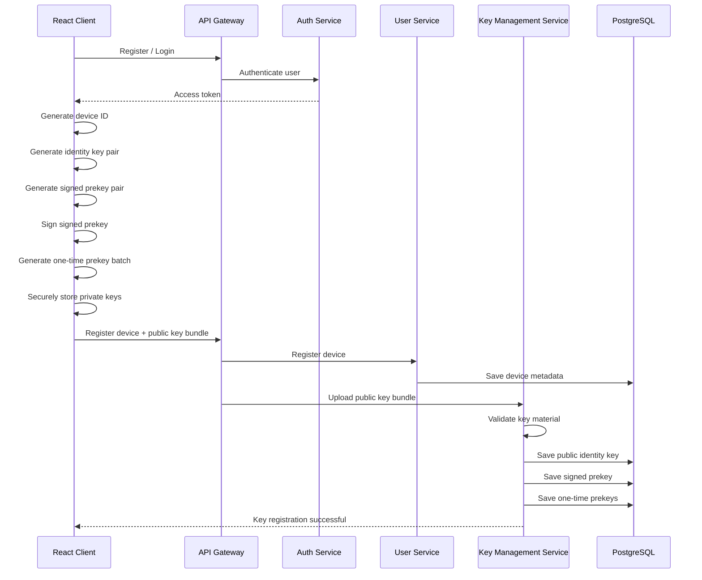
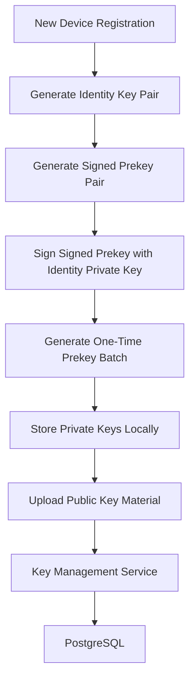
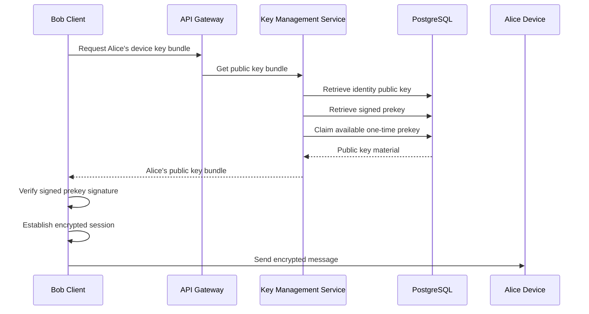
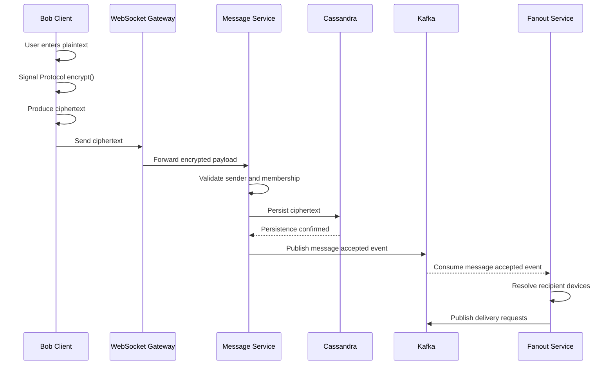
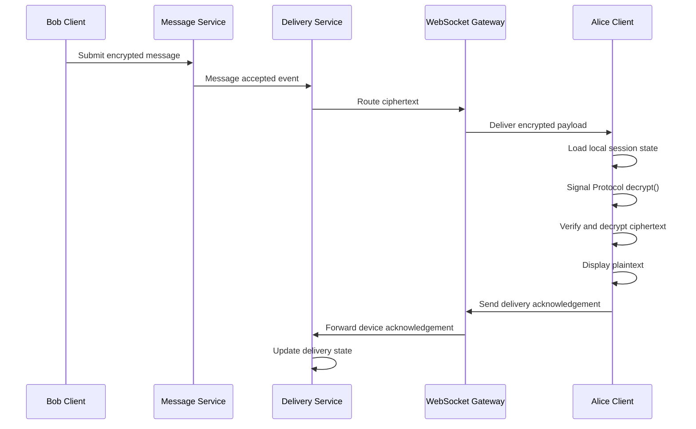
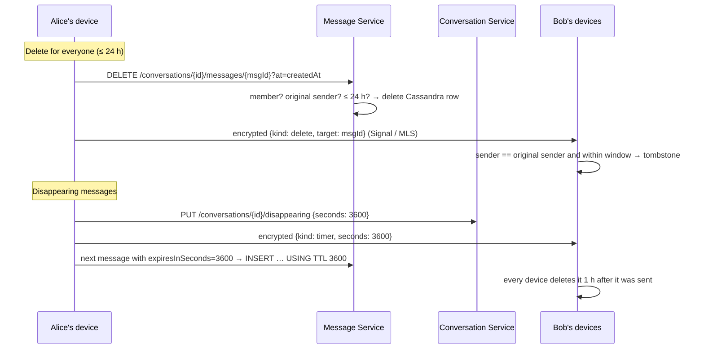
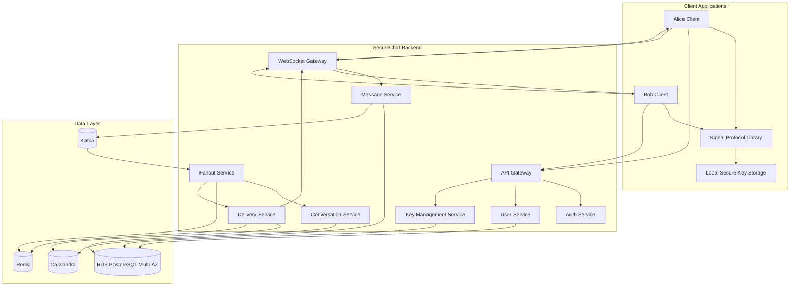

# SecureChat — Device Registration, Key Management & Message Encryption

**Document Type:** Technical Design Specification  
**Version:** 1.0  
**Status:** Proposed Design  
**Scope:** MVP — One-to-One End-to-End Encrypted Messaging

---

## 1. Purpose

This document defines how SecureChat handles:

1. User device registration.
2. Cryptographic key generation and management.
3. Public key registration and distribution.
4. One-to-one message encryption.
5. Message transmission and ciphertext persistence.
6. Message decryption on the recipient's device.
7. Key rotation, device revocation and recovery.

The main security objective is to ensure that message content is encrypted and decrypted exclusively on user devices.

The backend stores and distributes public keys and encrypted messages. It must never access users' private keys or plaintext message content.

## 2. Architecture Overview

### 2.1 Components

| Component | Responsibility |
|---|---|
| React Client | Device registration, key generation, encryption and decryption |
| API Gateway | Authentication and API routing |
| Auth Service | User authentication and access tokens |
| User Service | User profiles and device registration |
| Key Management Service | Public key registration, retrieval, rotation and prekey claiming |
| Conversation Service | Conversation membership and authorization |
| Message Service | Ciphertext validation and persistence |
| WebSocket Gateway | Real-time message transmission |
| Fanout Service | Resolve recipients and create delivery tasks |
| Delivery Service | Per-device delivery, retry and acknowledgement |
| PostgreSQL | User, device and public key metadata |
| Cassandra | Encrypted message history and delivery records |
| Redis | Presence and live device connection mapping |
| Kafka | Asynchronous message and delivery events |

### 2.2 Security Boundary

| Data | Client | Backend |
|---|---|---|
| Plaintext message | Accessible | Never accessible |
| Identity private key | Stored securely | Never accessible |
| Signed prekey private key | Stored securely | Never accessible |
| One-time prekey private keys | Stored securely | Never accessible |
| Identity public key | Accessible | Stored |
| Signed prekey public key | Accessible | Stored |
| One-time prekey public keys | Accessible | Stored |
| Encrypted message | Accessible | Stored and transmitted |

**Core principle:** Encryption and decryption happen on the client. The backend handles ciphertext and public key metadata only.

## 3. Device Registration

### 3.1 Registration Flow

When a user registers or logs in from a new device, SecureChat registers that device independently.

For example:

- Alice registers her account on her laptop.
- Alice later installs SecureChat on her mobile phone.
- Both devices receive separate device IDs and cryptographic identities.

Each device maintains its own identity key pair and prekeys.

### 3.2 Device Registration Sequence



### 3.3 Device Registration Data

Suggested `devices` table:

| Column | Description |
|---|---|
| device_id | Unique device identifier |
| user_id | Owner user ID |
| device_name | Laptop, mobile or browser |
| platform | WEB, IOS, ANDROID |
| device_status | ACTIVE, REVOKED |
| registered_at | Registration timestamp |
| last_seen_at | Last activity timestamp |

A device should be uniquely identifiable and associated with its owner.

### 3.4 Multi-Device Support

Each device has independent cryptographic keys.

| User | Device | Identity Key |
|---|---|---|
| Alice | Laptop | Alice Laptop Identity Key |
| Alice | Mobile | Alice Mobile Identity Key |
| Bob | Laptop | Bob Laptop Identity Key |

The backend must distinguish between a user and their individual devices.

This is important because message encryption and delivery may need to operate separately for every recipient device.

## 4. Cryptographic Key Management

### 4.1 Recommended Protocol

Use a maintained Signal Protocol implementation rather than developing a custom cryptographic protocol.

The Signal Protocol provides mechanisms for:

- Identity key management.
- Signed prekeys.
- One-time prekeys.
- Session establishment.
- Ratcheting and forward secrecy.
- Message encryption and authentication.

The session-establishment mechanism depends on the selected implementation and protocol version. Modern implementations may support PQXDH, while older or compatible deployments may use X3DH.

### 4.2 Key Types

Each registered device generates the following key material.

#### A. Identity Key Pair

A long-term cryptographic identity for the device.

| Key | Storage |
|---|---|
| Identity private key | Device only |
| Identity public key | PostgreSQL |

The identity private key must never be uploaded to SecureChat servers.

#### B. Signed Prekey Pair

A medium-term key used during session establishment.

| Key | Storage |
|---|---|
| Signed prekey private key | Device only |
| Signed prekey public key | PostgreSQL |
| Signature | PostgreSQL |

The client signs the signed prekey public material using its identity private key.

The recipient can verify the signature to confirm that the signed prekey belongs to the claimed device identity.

#### C. One-Time Prekey Pairs

Temporary key pairs used during session establishment.

For example, the client may generate an initial batch of 100 one-time prekeys.

| Key | Storage |
|---|---|
| One-time prekey private keys | Device only |
| One-time prekey public keys | PostgreSQL |
| Prekey claim state | PostgreSQL |

The client uploads the public portion of each key pair.

The server distributes an available one-time prekey when another device requests a key bundle.

### 4.3 Key Generation Flow



### 4.4 Database Schema

#### identity_keys

Stores public device identity information.

| Column | Description |
|---|---|
| id | Primary key |
| user_id | User reference |
| device_id | Device reference |
| public_key | Identity public key |
| algorithm | Key algorithm |
| created_at | Creation timestamp |

#### signed_prekeys

Stores signed prekey public material.

| Column | Description |
|---|---|
| id | Primary key |
| device_id | Device reference |
| prekey_id | Client-generated prekey ID |
| public_key | Signed prekey public material |
| signature | Signature from identity private key |
| algorithm | Key algorithm |
| created_at | Creation timestamp |
| expires_at | Optional rotation metadata |

#### one_time_prekey_inventory

Stores the available public one-time prekeys.

| Column | Description |
|---|---|
| id | Primary key |
| device_id | Device reference |
| prekey_id | Client-generated prekey ID |
| public_key | One-time prekey public material |
| status | AVAILABLE, CLAIMED |
| claimed_at | Claim timestamp |

Private key material must never be stored in these tables.

### 4.5 Key Storage on Client

For native mobile applications:

- iOS: Keychain and appropriate platform security facilities.
- Android: Android Keystore with encrypted local persistence where appropriate.

For web applications:

- Web Crypto API for supported cryptographic operations.
- IndexedDB for local persistence.
- Carefully protect against cross-site scripting (XSS).

Browser storage is not equivalent to hardware-backed mobile key storage.

Private key material should be protected at rest, and the implementation must consider browser session compromise, device compromise and account recovery.

## 5. Public Key Distribution

When Bob wants to start an encrypted conversation with Alice, Bob's device needs Alice's public key bundle.

### 5.1 Key Bundle Retrieval

The Key Management Service provides:

1. Alice's device identity public key.
2. Alice's signed prekey public key.
3. Alice's signed prekey signature.
4. An available one-time prekey public key, if one exists.

The server does not provide any private key.

### 5.2 Key Retrieval Sequence



### 5.3 One-Time Prekey Claiming

One-time prekeys must not be claimed by multiple clients.

PostgreSQL can use an atomic transaction and row locking.

Conceptual SQL:

```sql
BEGIN;

SELECT id, prekey_id, public_key
FROM one_time_prekey_inventory
WHERE device_id = :deviceId
  AND status = 'AVAILABLE'
ORDER BY id
FOR UPDATE SKIP LOCKED
LIMIT 1;

UPDATE one_time_prekey_inventory
SET status = 'CLAIMED',
    claimed_at = CURRENT_TIMESTAMP
WHERE id = :selectedId;

COMMIT;
```

The actual implementation must return the selected public key from the transaction and handle the case where no available prekey exists.

If no one-time prekey is available, the client can use the supported protocol fallback without one.

## 6. One-to-One Message Encryption

### 6.1 Initial Session Establishment

Before Alice and Bob exchange encrypted messages, their devices establish a cryptographic session.

For example:

1. Bob retrieves Alice's public key bundle.
2. Bob verifies Alice's signed prekey signature.
3. Bob's client performs the protocol's session-establishment procedure.
4. Bob's client derives session secrets locally.
5. Alice's device can independently establish the corresponding session when it receives the initial message.

The protocol implementation manages the required key agreement and session state.

The server does not calculate or store shared session secrets.

### 6.2 Message Encryption

When Bob sends Alice a message:

1. Bob types a plaintext message.
2. The React client passes the plaintext to the cryptographic library.
3. The library encrypts the message using the session state.
4. The client produces ciphertext and the required protocol message metadata.
5. The client sends the encrypted payload to the WebSocket Gateway.
6. The backend persists and routes the ciphertext.

Example plaintext:

```text
Hello Alice, how are you?
```

Illustrative encrypted payload:

```json
{
  "messageId": "msg-10001",
  "conversationId": "conv-100",
  "senderDeviceId": "device-bob-01",
  "ciphertext": "BASE64_ENCODED_ENCRYPTED_DATA",
  "protocolType": "SIGNAL",
  "clientMessageId": "client-msg-001"
}
```

This is a simplified transport envelope. Actual Signal Protocol messages have protocol-specific serialization and metadata requirements.

The server can read transport metadata such as the conversation ID and sender device ID, but not the plaintext message.

### 6.3 Encryption Sequence



The message should not be acknowledged as durably accepted until the required persistence and event-publication responsibility is established.

The outbox or CDC implementation must guarantee reliable event publication.

## 7. Message Delivery and Decryption

### 7.1 Recipient Delivery

After Fanout resolves Alice's devices:

1. Delivery Service creates a delivery task for each eligible device.
2. It checks Redis for the active WebSocket Gateway connection.
3. If Alice is online, ciphertext is routed to her device.
4. If Alice is offline, the ciphertext remains pending in Cassandra.
5. Alice reconnects later and receives pending messages.

### 7.2 Message Decryption

When Alice receives Bob's encrypted message:

1. Alice's client receives the ciphertext.
2. The Signal Protocol library identifies the appropriate session.
3. The library processes any required session-establishment message.
4. It derives or advances the appropriate cryptographic state.
5. It authenticates and decrypts the ciphertext.
6. The plaintext becomes available to the application UI.
7. Alice's client acknowledges successful receipt.

The backend never performs message decryption.

### 7.3 Decryption Sequence



### 7.4 Delivery Acknowledgement

Delivery and read receipts are separate from decryption.

| Status | Meaning |
|---|---|
| ACCEPTED | Backend accepted responsibility for the message |
| PERSISTED | Ciphertext was durably persisted |
| DELIVERED | Recipient device acknowledged receipt |
| READ | Recipient device reported that the message was read |
| FAILED | Delivery reached a terminal failure state |

A delivered acknowledgement does not prove that a human has read the message.

A read receipt is generated by the recipient client after the relevant user action.

## 8. Offline Message Delivery

If Alice is offline:

1. Bob sends the encrypted message.
2. Message Service persists ciphertext in Cassandra.
3. Fanout resolves Alice's eligible devices.
4. Delivery Service finds no active connection for Alice's device.
5. Delivery Service stores a pending delivery record.
6. Alice receives an optional generic push notification.
7. Alice reconnects.
8. Delivery Service retrieves pending messages.
9. Alice's device receives and decrypts the ciphertext.
10. Alice's device acknowledges delivery.

The push notification should not contain plaintext message content.

Cassandra stores the encrypted message. Redis stores current connection information. Kafka transports asynchronous events.

These responsibilities should remain separate.

## 9. Key Lifecycle Management

### 9.1 Identity Key

The identity key is long-lived.

It should not be rotated casually because changing device identity affects trust verification and session establishment.

If the identity key changes, contacts should be able to detect and verify the change.

### 9.2 Signed Prekey Rotation

Signed prekeys should be periodically replaced according to the protocol implementation's recommendations.

The client:

1. Generates a replacement signed prekey.
2. Signs its public material using the identity private key.
3. Uploads the replacement.
4. Retains the old private key long enough to process messages that may still reference it.
5. Deletes old private material when safe.

### 9.3 One-Time Prekey Replenishment

The client periodically checks its available one-time prekey count.

For example:

- Initial batch: 100 keys.
- Replenishment threshold: 20 available keys.
- Generate and upload a new batch when the threshold is reached.

These values are illustrative configuration choices, not protocol requirements.

**Implemented values (CURRENT MVP, `frontend/src/lib/crypto/keyManager.ts`):**

| Key material | Initial batch | Replenish when below | Rotation / retention |
|---|---|---|---|
| Signed prekey (Signal) | 1 | — | Rotated every **7 days**; previous private halves kept **30 days** for in-flight messages |
| One-time prekeys (Signal) | **100** | **20** available | Consumed once by atomic claim on key-service |
| MLS KeyPackages | **20** + 1 last-resort | **5** available | Consumed once per group Add; the last-resort package is reusable |
| Identity key (Signal) / MLS signature key | 1 per device | — | Never rotated; a new device = a new identity. The MLS signature key is bound to the Signal identity by an XEdDSA signature |

### 9.4 Device Revocation

When a device is lost or compromised:

1. User or administrator initiates device revocation through an authorized workflow.
2. User Service marks the device REVOKED.
3. Key Management Service stops distributing its public key bundle.
4. Authentication sessions are revoked.
5. Active WebSocket connections are terminated.
6. Contacts are informed of identity changes where appropriate.
7. New sessions are established with the user's remaining trusted devices.

Revocation does not magically erase private keys from a lost device. Group conversations also require appropriate protocol-level key rotation to prevent a removed member from decrypting future messages.

### 9.5 Group Key Rotation (MLS, CURRENT MVP)

Groups use MLS (RFC 9420, `ts-mls`). Every change to who can read the group is an MLS **Commit** that moves
the group to a new **epoch** with fresh secrets (TreeKEM). conversation-service orders commits with an
epoch compare-and-set (`group_metadata.epoch`, `mls_commits`): a commit built at epoch N is accepted only if
the group is still at N; a losing client gets `EPOCH_CONFLICT`, re-syncs and retries once.

| Trigger | Who | MLS operation | Effect |
|---|---|---|---|
| Add member(s) | OWNER / ADMIN | Add commit + Welcome per new device | New members read from epoch N+1 only (history: see §10.3) |
| Remove member | OWNER (anyone), ADMIN (members only) | Remove commit for all the user's leaves | Removed user cannot decrypt anything after the removal |
| Member leaves | the member | none by the leaver (MLS cannot remove itself) | Remaining clients notice stale leaves and commit their removal (device reconciliation) |
| Device registered / revoked | any member's client, automatically | `DEVICE_SYNC` commit (Adds for new devices of members, Removes for revoked/departed leaves) | Tree always equals the authoritative device list; jittered so members don't race. Triggered on a member's own reconnect, on membership changes, and **when a member's device comes online** (`chat.device.connected` → websocket-gateway sends a `device` frame to that user's peers; a peer whose tree lacks that device adds it within ~3 s) |
| **Rotate group keys** (Group info) | any member | Empty commit with a path update (`UPDATE`) | Fresh epoch secrets and a new leaf secret for the committer (post-compromise security) |

Own commits are persisted before submission (`mlspending`) so a crash after the server accepted a commit
can be recovered. Messages that arrive for an older epoch are processed with retained epoch secrets;
messages from before a device joined report "Sent before this device joined the group".

## 10. Multi-Device Encryption Considerations

A user may have multiple devices.

| User | Devices |
|---|---|
| Alice | Laptop, Mobile |
| Bob | Laptop, Mobile |

When Bob sends Alice a message, the system must account for all eligible Alice devices.

The sender's client must encrypt for each recipient device using the protocol's multi-device session model.

The backend performs device resolution and delivery, not encryption.

A message delivered to Alice's laptop does not automatically mean it has been delivered to Alice's mobile phone.

Each device has its own delivery state.

Do not assume a new device can decrypt historical messages simply because it belongs to the same user account.
Keys never leave a device, so history reaches a new device only by being **re-encrypted for it by a device
that can read it** (§10.2–10.3). There is no key escrow and no server-side backup of plaintext.

**Implemented policy (CURRENT MVP):**

| Question | Policy |
|---|---|
| Which sender devices receive synchronized sent messages? | All of the sender's other ACTIVE devices (Signal: one envelope per device; MLS: every leaf) |
| Which recipient devices are eligible? | ACTIVE devices of current members at send time (Fanout resolves per device) |
| How do new devices obtain history? | Automatically from the user's other devices, one month per request (§10.2) |
| Can old history be recovered? | Only from a device that still holds it; server copies are ciphertext for the devices that existed then |
| New group member? | Only what an OWNER/ADMIN allows at invite, re-encrypted by a member device (§10.3) |
| Device removal? | Device REVOKED + sessions revoked + socket closed; groups re-key via `DEVICE_SYNC` (§9.5) |

### 10.1 Load Older Messages (paging)

The chat shows the last month locally. **Load older messages** loads **one more month per click**:

1. The client pages server history (`GET /api/v1/conversations/{id}/messages`, 100 per page, newest first)
   until it has passed the next month boundary. Each row carries only the ciphertext envelope for the
   requesting device.
2. For each row the client:
   - skips it if already read locally (no duplicates);
   - **group, sent before I joined** → not shown; counted for one notice *"You can't see messages from
     before you joined"*;
   - **sent before this device existed** → not shown as a locked bubble; the month is requested from the
     user's other devices automatically (§10.2) and a banner shows *"Syncing older messages from your other
     device…"*;
   - otherwise a delivery gap → placeholder *"Not received on this device yet — resyncing"* and a `sync`
     request to the Delivery Service.
3. The scroll position is preserved while older messages are inserted above.

### 10.2 History on a New Device (automatic, no approval)

```mermaid
sequenceDiagram
    participant N as New device
    participant U as user-service (relay)
    participant O as Other device (same user)
    participant K as key-service
    N->>N: first start (or Load older reaches an unreadable month)
    N->>N: one-time X25519 key; sign "request-v2:user:device:fromMs:toMs:ephKey" with identity key
    N->>U: POST /devices/transfers {ephKey, signature, windowFrom, windowTo}
    O->>U: poll every 15 s: GET /devices/transfers
    O->>K: identity key of N
    O->>O: verify signature (bad → decline); hold messages in window?
    O->>U: POST /{id}/approve (compare-and-set: first device wins)
    O->>O: gzip(JSON of messages in window) → HPKE seal to ephKey; sign manifest
    O->>U: PUT chunks (≤150 KB) + POST complete {manifest, signature}
    O->>O: notice "N messages were sent to your new device ‘name’ — Not you? Revoke"
    N->>U: GET chunks; verify manifest signature + SHA-256; HPKE open; import
    N->>U: DELETE /{id} (ciphertext deleted)
```

| Rule | Value |
|---|---|
| Window per request | ≤ **31 days** (one month), bound into the signature as epoch milliseconds |
| Requests | ≤ 3 open, ≤ **30 per user per day**, 24 h expiry |
| Who answers | Any ACTIVE device of the same user that holds messages in the window; first to approve wins |
| Archive size | ≤ 25 MB, ≤ 200 chunks |
| Server sees | ephemeral public key, signatures, window, ciphertext — never plaintext or private keys |
| Clock skew | windows are padded by 10 minutes; a message matches by its send time or server time |

**Trust model.** The earlier manual flow required the user to compare a 20-digit code on both devices. It
was removed for usability, so the answering device trusts the device directory: anyone able to register a
device on the account (a stolen password, or a compromised server inventing a device) receives up to one
month of history per request. Mitigations: signed, window-bound requests; daily cap; the visible
*"sent to new device — Not you? Revoke"* notice and sidebar banner on every sending device; a password
change signs out all other sessions.

### 10.3 Group History for New Members

MLS gives a new member only epochs after their Add commit. At invite, an OWNER/ADMIN chooses what earlier
history the new member may see: **Don't share · Last 100 messages · Last 10 minutes · 1 hour · 10 hours ·
1 day · 7 days · 30 days · All history**.

```mermaid
sequenceDiagram
    participant A as Admin device
    participant C as conversation-service
    participant M as Member device(s)
    participant N as New member device
    A->>C: Add commit + Welcomes (epoch N → N+1)
    A->>C: POST /groups/{id}/history-grants {scope} (OWNER/ADMIN only)
    A->>M: MLS "history-grant" {grantId, scope, grantedAt, forUserIds} (epoch N+1, also to N)
    alt inviter's device holds messages in scope (normal case)
        A->>C: POST /history-grants/{gid}/claim → shareId (immediately)
    else inviter's device holds nothing in scope
        M->>C: after 20–30 s: claim → shareId (first wins, others 409)
    end
    Note over A,M: claimer: gzip(JSON of messages in scope) → AES-256-GCM, fresh key,<br/>AAD = conversationId + shareId
    M->>C: PUT history-shares/{sid}/chunks + complete (ciphertext only)
    M->>N: MLS "history-share" {grantId, shareId, key, sha256, chunkCount}
    N->>N: accept only for a grant received from an OWNER/ADMIN; re-apply the grant's scope
    N->>C: GET chunks (current members only) → verify hash → decrypt → import "shared by <member>"
```

| Rule | Value |
|---|---|
| Who may grant | OWNER, ADMIN (server-enforced; receivers also check the sender's role) |
| Who fulfils | **The inviter's device, immediately**, with whatever it holds within the scope (it is online — it just added the member). Only if it holds nothing in scope may another member's device claim the grant after 20–30 s (claim is compare-and-set) |
| Invitee's later devices | The sharing device remembers each share for 7 days; when a device of the invitee joins later (e.g. opened in a new browser after the invite), it re-sends the key in the current epoch. The share carries the scope, so that device can apply it without the original grant message |
| Joining promptly | A device with a pending Welcome joins on any group event, before sending, and every 15 s; group messages that arrive before it joined are deferred (not acknowledged, no "Unable to decrypt" bubble) and replayed after joining |
| Who may download | Current members only (removed members → 404); useless without the key in the MLS epoch |
| Limits | 25 MB, 200 chunks, ≤ 3 unfinished per user; grant 7 days, share 30 days, hourly purge |
| What is shared | sender, body, timestamps — no receipts |
| Authenticity | MLS authenticates the grant and the sharer; the shared messages are vouched for by the sharing member, not their original senders, and are labelled "shared by …" |
| Nobody can share / "Don't share" | The member sees *"You can't see messages from before you joined"* |

### 10.4 Group Roles and Access Rights

| Action | OWNER | ADMIN | MEMBER |
|---|---|---|---|
| Send / read messages | ✅ | ✅ | ✅ |
| Invite members (choose history scope) | ✅ as **Admin or Member** | ✅ as **Member only** | ❌ |
| Remove a member | ✅ | ✅ | ❌ |
| Remove an admin | ✅ | ❌ | ❌ |
| Remove the owner | ❌ (nobody) | ❌ | ❌ |
| Promote member → admin / demote admin → member | ✅ | ❌ | ❌ |
| Edit group name / description (not E2EE: visible to the server) | ✅ | ✅ | ❌ |
| Create a history grant | ✅ | ✅ | ❌ |
| Fulfil a history grant (share from own device) | ✅ | ✅ | ✅ |
| Rotate group keys | ✅ | ✅ | ✅ |
| Leave the group | ✅ (ownership passes to an admin, else a member) | ✅ | ✅ |

The owner is whoever created the group; there is always exactly one. Every rule above is enforced by
conversation-service; the UI only hides what the server would refuse.

### 10.5 Edit, Delete and Disappearing Messages

No new keys are involved: each action is an **encrypted control message** sent through the same Signal session
(one-to-one) or MLS group as a normal message, so the server learns nothing about which text changed.

| Control payload | Sent by | Time limit (server time) | Receiving devices |
|---|---|---|---|
| `edit {target, body}` | original sender | 1 hour | replace the text, show "edited" |
| `delete {target}` | original sender | 24 hours | show "This message was deleted", drop the plaintext |
| `timer {seconds}` (0 = off) | any member | — | update the chat timer, show a system line |
| `text {…, expiresIn}` | sender | — | remove the message at server send time + `expiresIn` |



Rules:

- Receivers check the sender and the window themselves, using the server's `createdAt` of both the target and the
  notice (+ 2 min tolerance), so a forged or late edit/delete from another member is ignored even though it is
  validly encrypted.
- Server enforcement covers what the server can see: only the sender may remove a row from history, within 24 h;
  timer values outside the allowed set are rejected (`400`).
- Deleted and expired messages are skipped when history is synced to a new device or shared with a new group
  member; "delete for me" ids are remembered locally so they are never re-imported.
- Limits: a recipient can copy or screenshot a message before it is edited, deleted or expires, and a modified
  client can ignore notices. Disappearing messages reduce stored history; they are not a guarantee against a
  recipient who wants to keep a copy.

## 11. Security Requirements

| Requirement | Implementation |
|---|---|
| Client-side encryption | Use maintained Signal Protocol implementation |
| Private key protection | Platform secure storage and encrypted local persistence |
| No server-side decryption | Message Service only handles ciphertext |
| Public key validation | Verify signed prekey signatures |
| One-time prekey safety | Atomic claim and unique key IDs |
| Device authentication | Bind access tokens to registered devices |
| Device revocation | Revoke sessions and stop key distribution |
| Transport security | TLS for REST and WebSocket connections |
| Database security | Encryption at rest and least-privilege access |
| Key change detection | Provide identity verification and change notifications |
| Audit | Record administrative and security-sensitive operations |

### Important limitations

End-to-end encryption protects message content from the backend, but does not hide all metadata.

The server may still observe:

- Sender and recipient references.
- Conversation identifiers.
- Message timestamps.
- Device identifiers.
- Message sizes.
- Delivery and read status.
- Network connection metadata.

E2EE also cannot protect plaintext displayed on a compromised endpoint.

Edit, delete-for-everyone and disappearing messages rely on the recipients' clients honouring them; they cannot
recall a copy someone has already saved (§10.5).

## 12. MVP Implementation Plan

| Phase | Feature | Deliverable |
|---|---|---|
| 1 | Device registration | Register user devices and maintain device identity |
| 2 | Key generation | Generate identity, signed prekey and one-time prekey material |
| 3 | Local key storage | Securely persist private keys on supported clients |
| 4 | Public key registration | Upload and store public key bundles |
| 5 | Key distribution | Retrieve and atomically claim public prekeys |
| 6 | Session establishment | Establish client-to-client cryptographic sessions |
| 7 | Message encryption | Encrypt messages before sending |
| 8 | Message persistence | Store ciphertext in Cassandra |
| 9 | Message delivery | Deliver ciphertext through WebSocket |
| 10 | Message decryption | Decrypt on recipient device |
| 11 | Receipts | Implement per-device delivered and read acknowledgements |
| 12 | Key lifecycle | Prekey replenishment, rotation and device revocation |

## 13. Recommended Final Architecture



### Final Design Principles

1. Private keys are generated and retained on the client.
2. Public keys and prekey inventory are managed by Key Management Service.
3. PostgreSQL stores public key metadata, not private keys.
4. Signal Protocol manages session establishment, encryption and decryption.
5. Message Service stores ciphertext only.
6. Fanout and Delivery Services route encrypted messages without decrypting them.
7. Each device has an independent cryptographic identity and delivery state.
8. Device revocation and key rotation are explicit security workflows.

**Architecture decision:** SecureChat will use client-side Signal Protocol encryption, PostgreSQL Multi-AZ for public key management and device metadata, and Cassandra for encrypted message persistence and delivery state. The server will not possess user private keys or message decryption capability.
